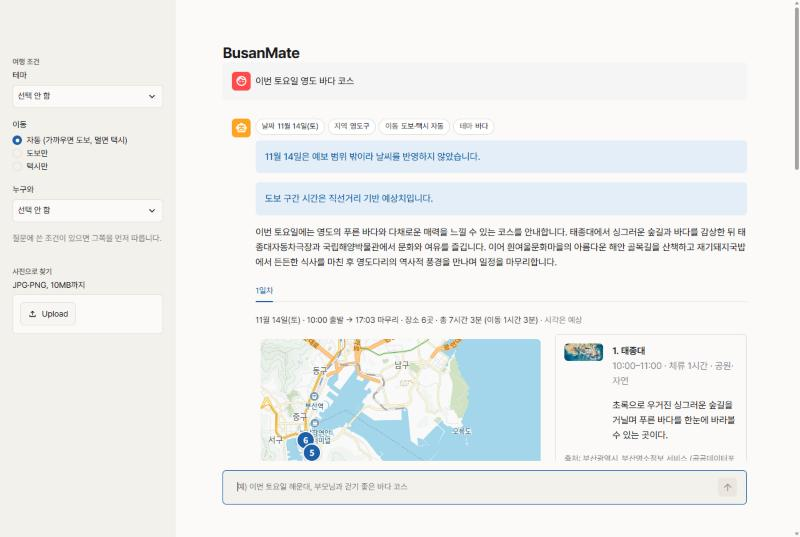
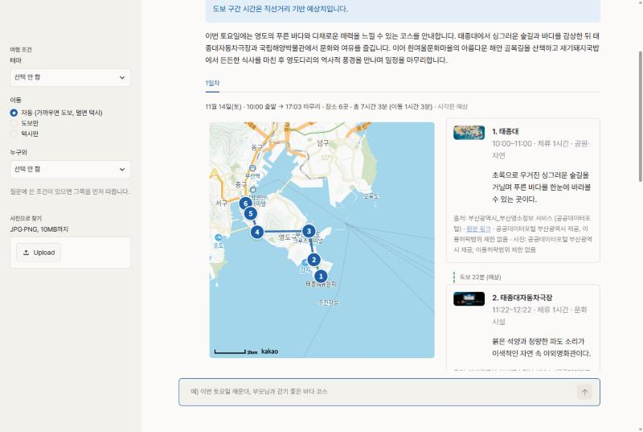
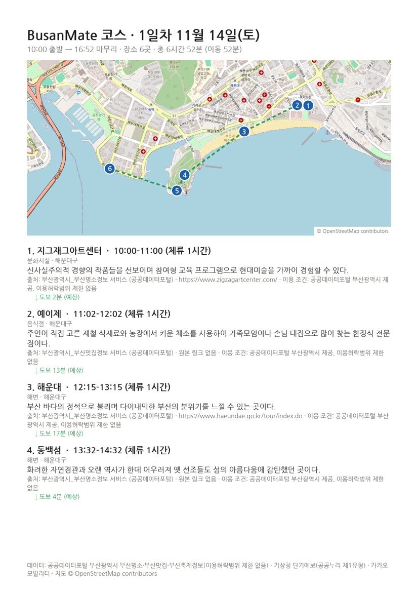

# BusanMate — 부산 맞춤 여행코스 안내

"이번 토요일 해운대에서 부모님과 걷기 좋은 바다 코스"처럼 말하면, 부산시 공공데이터에 실제로 있는 장소만으로 하루~2박 3일 코스를 짜 주는 AI 서비스입니다. 장소마다 출처와 원본 링크를 붙이고, 지도·방문 예정 시각·이동 시간까지 한 화면에 보여 줍니다. 대학 프로젝트 프로토타입입니다.



## 주요 기능

- **자연어 코스 추천:** 날짜·지역·동행·이동수단·테마를 문장에서 읽고, 하루 2~6곳을 골라 이동거리가 가장 짧은 순서로 배치합니다(최대 3일).
- **해석한 조건 확인:** 응답 맨 위에 AI가 읽은 조건(날짜, 지역, 동행, 이동, 테마)을 칩으로 보여 줘서 잘못 읽었는지 바로 알 수 있습니다.
- **시각과 이동 시간:** 카드마다 방문 예정 시각·체류 시간·다음 장소까지의 이동 시간을 붙이고, 일차마다 출발~마무리 시각, 장소 수, 총 소요 시간을 요약합니다.
- **도보·택시:** 이동수단은 도보와 택시만 씁니다. 가까우면 걷고 멀면 택시를 탑니다. "걸어서"라고 해도 걸어서 30분이 넘는 구간은 그 구간만 택시로 계산하고 "걸으면 ○분 걸려 택시로"라고 알려 줍니다. 택시 구간은 카카오모빌리티로 실제 시간과 요금을 조회합니다.
- **지도:** 카카오맵에 번호 마커와 구간 선(도보는 초록 점선, 택시는 파란 실선)을 그립니다. 마커를 누르면 해당 장소 카드가 강조됩니다.
- **날씨·축제 반영:** 기상청 단기예보에서 강수확률이 60% 이상인 날은 실내 장소에 점수를 더 줍니다. 방문 기간에 열리는 부산 축제도 함께 알려 줍니다.
- **대화형 수정:** "카페 하나 추가해줘", "두 번째 장소 빼줘"처럼 말하거나 결과 아래의 "실내로 바꾸기 / 카페 추가 / 더 짧게" 버튼을 누르면 장소 하나만 바꾸고 순서와 이동 시간을 다시 계산합니다.
- **사진으로 찾기:** 부산 명소 사진을 올리면 CLIP으로 어느 곳인지 찾습니다. 닮은 명소가 없으면 사진의 분위기를 글로 풀어 비슷한 장소를 추천하고, "코스에 넣기"로 바로 추가할 수 있습니다. 사진은 저장하지 않습니다.
- **직접 편집:** 일차 탭에서 카드를 드래그해 순서를 바꾸거나 "빼기"로 지우면, 채팅을 거치지 않고 이동 시간과 시각을 바로 다시 계산해요. "다른 곳으로 교체"는 같은 분류에서 동선상 덜 돌아가는 후보 3곳을 보여 줘요.
- **근거 표시:** 코스 위에 "공공데이터 장소 N곳 · 모두 출처 확인됨" 배지를 달고, 카드마다 "왜 이곳?"(요청한 장소, 테마, 실내·비 예보, 점심 시간, 앞 장소에서 걸어서 몇 분)을 보여 줘요. 구간의 "(예상)"에 마우스를 올리면 계산 방식이 나와요.
- **예상 비용과 예산:** 식비(1인, 맛집 설명의 대표 메뉴 가격, 없으면 기본 단가)와 택시비(1대, 카카오 실측 요금, 없으면 부산 택시 요금표)를 합쳐 보여 주고, 사이드바에 넣은 1인 예산을 넘으면 알려 줘요.
- **공유·저장:** "공유 링크 만들기"는 코스를 DB에 저장하고 `/?course=<id>` 링크를 줘요(읽기 전용). "코스 저장"은 이 브라우저 세션의 "저장한 코스" 목록에 넣고, 불러오면 다시 편집할 수 있어요. 로그인은 없어요.
- **내보내기:** 코스를 PDF(일자별 장소·시각·이동 시간·지도·출처와 이용 조건, 한글 폰트)로 내려받거나, 메신저에 붙여 넣을 요약 텍스트를 복사할 수 있습니다.

<table>
<tr>
<td width="55%"></td>
<td width="45%"></td>
</tr>
<tr>
<td>번호 마커 지도와 장소 카드(썸네일, 시각, 출처)</td>
<td>PDF 내보내기 (지도 © OpenStreetMap contributors)</td>
</tr>
</table>

## 기존 서비스와의 차이

일반 지도·여행 앱이나 범용 챗봇과 비교해, 이 프로토타입에서 실제로 구현한 것과 아직 못 한 것을 구분해 적습니다.

| 항목 | 상태 | 내용 |
|---|---|---|
| 출처·원본 링크 표시 | 구현 | 장소 카드마다 제공처, 원본 링크, 이용 조건을 붙입니다(PDF 포함). 원천 데이터에 링크가 없으면 "원본 링크 없음"으로 표시합니다. 출처가 없는 장소는 응답에서 뺍니다. 날씨를 쓰면 기상청(공공누리 제1유형)을 함께 표기합니다. |
| DB에 없는 장소 차단 (`verify_places`) | 구현 | LLM에는 이번 턴 후보의 id만 보여 주고 `[[place_id]]` 마커로만 인용하게 합니다. 후보 밖 id가 든 문장은 지우고, 남은 마커는 DB 이름으로 바꿉니다. 장소 이름·좌표·출처는 LLM 출력이 아니라 DB에서 채웁니다. 단위 테스트로 확인했고, 평가 질의 50개의 환각 건수는 `python -m eval.run_eval`로 잴 수 있습니다(아직 보고서로 남기지 않음). |
| 운영시간 반영 | **미구현** | 운영시간은 원문으로만 저장하고 파싱하지 않았습니다. 휴무일·영업시간으로 거르지 않습니다. 방문 예정 시각은 출발 10시와 장소당 체류 60분(초안 값)에 이동 시간을 더한 추정치입니다. |
| 날씨·선호 기반 점수화 | 구현 | `S = 0.4·유사도 + 0.3·선호 + 0.2·날씨 − 0.1·거리`(초안 가중치)를 LLM이 아니라 코드로 계산합니다. 선호는 테마별 분류 가산점입니다(예: 바다 테마는 해변, 해변 1km 안, 이름에 해안 키워드가 있는 장소). 예보 범위(약 5일) 밖이면 날씨를 반영하지 않고 그 사실을 알립니다. |
| 대화형 수정 | 구현 | 직전 코스에서 장소 하나를 바꾸거나 더하거나 빼고(`edit_course`), 나머지는 유지한 채 순서와 이동 시간만 다시 계산합니다. 한 번에 장소 하나씩만 바꿉니다. |

## 동작 방식

1. **조건 추출:** Gemini가 문장을 날짜·지역·동행·테마·이동수단으로 바꿉니다. 지역이나 날짜가 없으면 되묻습니다.
2. **검색:** PostgreSQL의 속성(구·분류·실내 여부)으로 거르고 Chroma 벡터 유사도로 후보 30곳을 고릅니다. 후보가 모자라면 조건을 풀고 알립니다.
3. **코스 계산(코드):** 점수화 → 장소 선택(같은 분류 3연속 금지, 하루 음식점 2곳·맛집 테마 3곳까지) → 순열 전수 탐색으로 방문 순서 → 다일 일정은 위치로 묶어 날짜별로 나눕니다.
4. **이동 시간:** 도보와 계획 단계의 택시는 직선거리 × 보정계수로 추정하고("예상" 표시), 택시 구간은 카카오모빌리티로 실측합니다. 이동 시간은 저장·캐시하지 않습니다.
5. **설명 생성:** Gemini가 추천 이유를 쓰고, `verify_places`가 DB에 없는 장소가 든 문장을 지웁니다. LLM이 실패하면 규칙 기반 해석과 DB의 장소 소개 문구로 대신합니다.

## 구조

| 계층 | 위치 | 내용 |
|---|---|---|
| 프레젠테이션 | `ui/` | Streamlit 채팅·카카오맵·사진 업로드, PDF·공유 텍스트(`ui/export.py`) |
| API | `api/` | FastAPI (API-001~008), 요청 한도, 관리자 토큰 |
| 에이전트 | `agent/` | LangGraph 오케스트레이터, 조건 추출, 근거 검증 응답 |
| 서비스·도구 | `services/`, `tools/` | 검색, 점수화·경로, 이미지(CLIP), LLM 클라이언트 / 날씨·축제·길찾기 도구 |
| 데이터 | `pipeline/`, `db/` | 공공 API 수집·적재, PostgreSQL 스키마, Chroma 벡터 |

모든 수치(가중치, 임계값, 체류 시간 등)는 [config.yaml](config.yaml)에 있는 초안 값입니다. 비밀값은 `.env`에만 둡니다. 설계 문서는 [docs/](docs/)에 있습니다(SRS, 프로젝트 계획서, SDD).

## 실행

필요한 것: Docker(Docker Compose 포함), 공공데이터포털·카카오·Gemini API 키.

1. `.env.example`을 `.env`로 복사하고 값을 채웁니다(공공데이터포털, 카카오, Gemini, 관리자 토큰, DB 비밀번호 `POSTGRES_PASSWORD`). `.env`는 커밋하지 않습니다.
2. 한 번에 띄웁니다. ui(8501), api(8000), db(PostgreSQL, 5432), vector(Chroma, 8001)가 함께 뜨고 DB 스키마는 처음 뜰 때 만들어집니다. 첫 빌드는 PyTorch 때문에 몇 분 걸립니다.
   ```bash
   docker compose up -d --build
   ```
3. 처음 한 번 데이터를 적재합니다. 장소·축제·이미지 임베딩까지 하며, Gemini 무료 한도 때문에 10분 정도 걸립니다. 이후에는 바뀐 장소만 처리합니다.
   ```bash
   docker compose exec api python -m pipeline.run
   ```
   API를 쓸 수 없을 때는 시드 CSV(공공데이터 원본 48행)로 적재할 수 있습니다.
   ```bash
   docker compose exec api python -m pipeline.run --seed
   ```
4. 브라우저에서 `http://localhost:8501`을 엽니다. 상태 확인은 `http://localhost:8000/api/health`입니다. 관리자 화면(데이터 수집)은 `http://localhost:8501/?admin=1`에서 토큰을 넣어 씁니다.
5. 카카오 개발자 콘솔에서 JavaScript 키의 "JavaScript SDK 도메인"에 UI 주소(예: `http://localhost:8501`)를 등록해야 지도가 보입니다.

중지는 `docker compose down`입니다. 데이터는 볼륨에 남고, 지우려면 `docker compose down -v`를 씁니다.

### 로컬 개발

```bash
python -m venv .venv && .venv/Scripts/pip install -r requirements.txt
```
```bash
docker compose up -d db vector
```
```bash
.venv/Scripts/uvicorn api.main:app --reload --port 8000
```
```bash
.venv/Scripts/streamlit run ui/app.py
```

테마(색·폰트)는 `.streamlit/config.toml`에 있어서 저장소 루트에서 실행해야 적용됩니다. 테스트는 `pytest -q`(DB가 없으면 DB 테스트는 skip), 린트는 `ruff check .`입니다. 사진 인식 평가는 `python -m eval.photo_eval <폴더>`입니다.

## 데이터 출처와 이용 조건

| 데이터 | 제공처 | 이용 조건 |
|---|---|---|
| 부산 명소·맛집·축제 정보 (장소 설명, 좌표, 대표 이미지) | 공공데이터포털 부산광역시_부산명소정보·부산맛집정보·부산축제정보 서비스 | 이용허락범위 제한 없음 |
| 단기예보 (강수확률) | 기상청 (공공데이터포털) | 공공누리 제1유형(출처 표시) |
| 자동차 길찾기 (택시 구간 시간·요금) | 카카오모빌리티 | 저장·캐시하지 않음 |
| 지도 | 카카오맵 | 카카오 이용약관 |
| PDF 내보내기 지도 이미지 | OpenStreetMap 타일 | ODbL, "© OpenStreetMap contributors" 표기 |

화면의 모든 장소에는 제공처와 원본 링크(없으면 "원본 링크 없음")가 함께 표시됩니다. 도보 구간 시간, 방문 예정 시각, 조회에 실패한 택시 구간은 추정치이며 "예상"으로 표시합니다.

## 한계

- 운영시간·휴무일을 반영하지 않습니다(위 표 참고).
- 해안 판정은 해변 대표 좌표와 이름 키워드로만 합니다. 키워드에 없는 해안 장소는 바다 테마 가산점을 받지 못할 수 있습니다.
- 원천 데이터에 분류 필드가 없어 이름 규칙으로 분류를 추정합니다. 규칙에 걸리지 않은 장소는 "관광지"로 둡니다.
- 기상청 단기예보만 써서 약 5일 뒤부터는 날씨를 반영하지 않습니다.
- Gemini 무료 등급 한도에 걸리면 규칙 기반 해석으로 처리되고, 화면에 그 사실을 알립니다.
- PDF는 페이지를 이미지로 그려 만들기 때문에 PDF 안에서 글자를 검색하거나 복사할 수 없습니다.

## 로드맵

한 주제를 깊게 파는 기능으로 **예산(식비·택시비 합계와 초과 경고)**을 먼저 만들었어요. 카카오 실측 택시 요금과 맛집 데이터의 메뉴 가격을 그대로 쓸 수 있고, 계산이 결정적이라 테스트하기 쉬워서예요. 아래 두 가지는 다음 후보예요.

- **장소 설명 읽어 주기(TTS):** 카드의 추천 이유·소개를 브라우저 음성 합성(Web Speech API)으로 읽어 주는 버튼. 서버 비용 없이 붙일 수 있지만 한국어 음성 품질이 브라우저마다 달라 확인이 필요해요.
- **"이번 주말 축제 포함" 옵션:** 축제 데이터(현재 38건)를 방문 날짜와 맞춰 코스에 넣는 기능. 축제 행에 좌표가 없는 경우가 많아 주소 → 좌표 변환(지오코딩)이 먼저 필요해요. 지금은 방문 기간의 축제를 답변에 알려 주는 데까지만 해요.

## AI 활용

LLM·VLM은 Google Gemini(무료 등급)를 `LLMClient` 인터페이스 뒤에서 사용합니다. 장소 이름·좌표·출처는 항상 DB에서 채우고, 점수화와 경로 계산은 코드가 합니다. 설계 문서 초안과 이 저장소의 코드 작성에는 Claude(Anthropic)를 활용했으며, 자세한 내역은 각 문서 부록에 있습니다.
