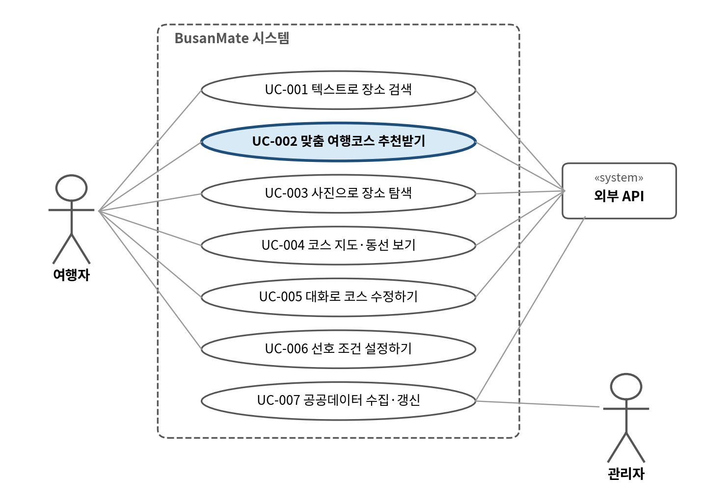
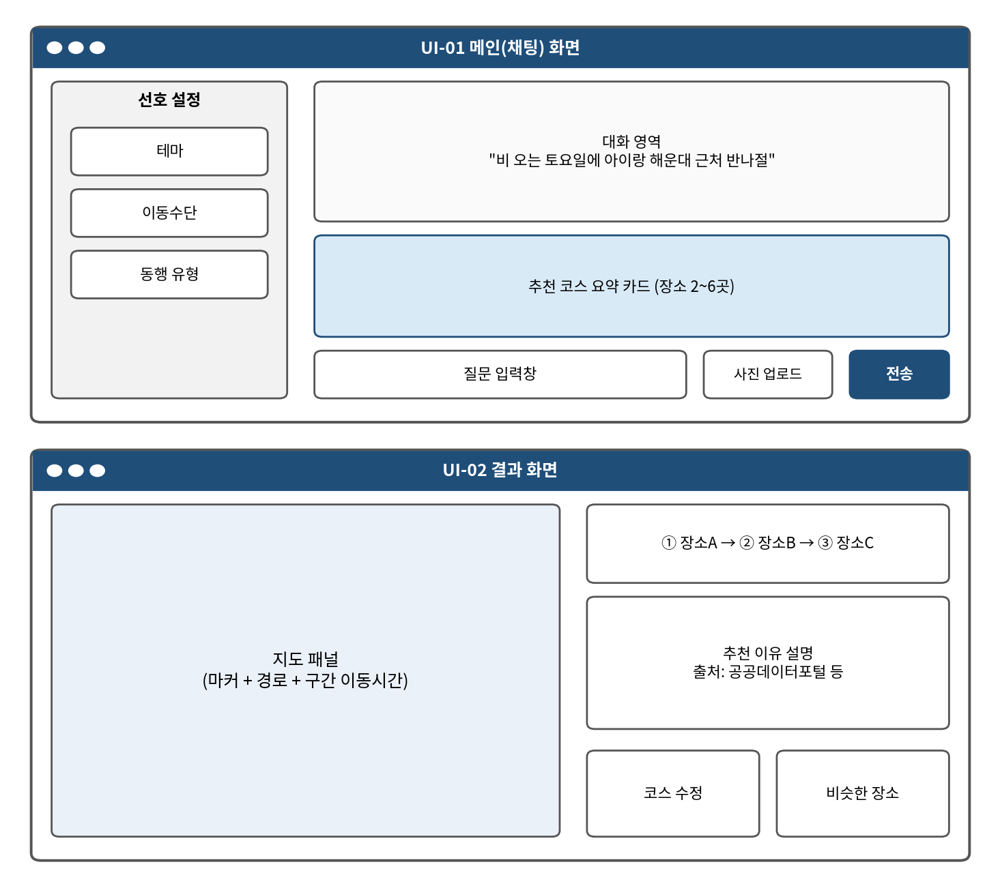

<!-- 01_요구사항명세서SRS_BusanMate.docx에서 자동 생성 (docs/docx2md.py). 직접 수정하지 말 것 -->

소프트웨어 요구사항 명세서

Software Requirements Specification (SRS)

문서 코드: SRS

| 프로젝트명 | BusanMate — 부산 맞춤 여행코스 안내 서비스 |
|---|---|
| 팀명 | [팀명 입력] |
| 팀원 | 김지호 / 2243577 / PM·LLM 에이전트
김성민 / 2242764 / 프론트, 연동
장우혁 / 2254772 / 데이터 엔지니어
이주호 / 2143325 / AI, 이미지 |
| 버전 | v1.0 |
| 작성일 | 2026-10-13 |
| 담당교수 | 임한신 |

# 문서 관리

| 버전 | 날짜 | 작성자 | 변경 내용 |
|---|---|---|---|
| 0.1 | 2026-10-06 | 김지호 | 초안 작성 |
| 0.2 | 2026-10-13 | 김지호 | 검토 반영 (FR-006 연속 카테고리 제한, 2박 3일 범위 등) |
| 1.0 | 2026-10-13 | 김지호 | 최종본 |

# 1. 문서 개요 (Introduction)

## 1.1 목적 (Purpose)

본 SRS는 부산 맞춤 여행코스 안내 서비스 BusanMate가 만족해야 할 기능, 비기능, 데이터, AI 요구사항을 정의한다.

## 1.2 프로젝트 범위 (Scope)

해결하려는 문제: 부산 관광·문화 정보는 공공데이터포털, 한국관광공사 TourAPI 등에 흩어져 있어 여행자가 직접 비교·조합하기 어렵다. 또한 일반 LLM은 최신 폐업·휴관 정보나 축제 일정을 반영하지 못해 존재하지 않거나 오래된 장소를 답할 위험이 있다(환각).

핵심 서비스: ① 자연어 장소 검색(RAG) ② 선호를 반영한 맞춤 여행코스 추천(당일~2박 3일, 날씨 반영은 선택) ③ 사진 기반 장소 탐색(CLIP·VLM) ④ 지도·동선 표시 ⑤ 날씨·축제 연동(선택). 과제의 핵심 기능 3개 이상은 ①~③(필수)로 충족한다. 모든 장소는 공공데이터에 실제로 있는 항목이며 출처와 함께 제공한다.

범위: 반나절부터 최대 2박 3일까지의 부산 일정을 다룬다. 범위 제외: 숙박·교통 예약 및 결제, 숙소 추천, 부산 외 지역, 3박 이상 일정, 모바일 앱, 다국어 지원.

## 1.3 용어 및 약어 (Definitions & Acronyms)

| 용어/약어 | 정의 |
|---|---|
| LLM | Large Language Model |
| VLM | Vision-Language Model |
| RAG | Retrieval-Augmented Generation. DB에서 찾은 자료를 근거로 LLM이 답변을 생성하는 방식 |
| 에이전트 / tool calling | LLM이 질의를 보고 사전에 정의된 도구(함수·API)를 골라 호출하는 구조 |
| CLIP | 이미지와 텍스트를 같은 벡터 공간에 임베딩하는 모델. 이미지 유사도 검색에 사용 |
| 코스 | 하루 기준 방문 순서가 정해진 2~6개 장소의 목록과 구간별 이동 정보. 여러 날 일정은 날짜별 코스로 구성한다 |
| 근거(출처) | 응답 속 각 장소가 유래한 공공데이터 항목과 그 제공처 |
| 평가셋 | 정확도 측정을 위해 팀이 미리 만들어 두는 질의 50개(정답 조건·정답 장소 포함)와 미사용 사진 모음 |
| Precision@5 | 상위 5개 추천 결과 중 질의 의도에 맞는 장소의 비율 |
| Top-5 정확도 | 정답 장소가 유사도 상위 5개 안에 포함된 사진의 비율 |
| 공공누리 | 공공기관 저작물의 이용 조건을 표시하는 한국의 공공 저작물 개방 라이선스 체계 |

# 2. 전체 설명 (Overall Description)

## 2.1 제품 관점 (Product Perspective)

BusanMate는 독립형 웹 서비스(Streamlit 프론트엔드 + FastAPI 백엔드)이며 다음 외부 서비스와 연동한다: 공공데이터포털·TourAPI(장소·행사), 기상청 예보 API(날씨), 카카오맵(지도 표시)과 카카오 모빌리티 길찾기 API(이동시간), 외부 LLM/VLM API. 장소 데이터는 배치로 수집해 자체 DB(PostgreSQL + 벡터 DB)에 적재하고, 날씨·이동시간처럼 자주 바뀌는 정보만 질의 시점에 조회한다. LLM은 질의 해석과 설명 생성을 맡고, 점수화와 동선 최적화는 자체 코드가 수행한다.

## 2.2 대상 사용자 (Target Users)

| 사용자 유형 | 특징 | 주요 목표 | 권한/제약 |
|---|---|---|---|
| 여행자 (주 사용자) | 부산을 방문하는 개인·커플·가족 여행자, 부산 방문객이 주 대상. 부산 거주자·대학생도 포함 | 조건에 맞는 반나절~2박 3일 코스 받기, 사진으로 장소 찾기 | 일반 사용자. 로그인 없이 세션 단위로 선호 저장 |
| 관리자 | 서비스를 운영하는 개발팀 | 공공데이터 수집·갱신, 로그·품질 지표 확인 | 관리 권한. 관리자 토큰 필요 |

## 2.3 운영 환경 (Operating Environment)

Client: PC 웹 브라우저 (Chrome/Edge 최신 버전)

Server: Linux / Docker, Python 3.11, FastAPI

External AI/API: tool calling을 지원하는 LLM·VLM API(모델은 설계 단계에서 확정), 공공데이터포털·TourAPI, 기상청 예보 API, 카카오맵, 카카오 모빌리티 길찾기

Database: PostgreSQL(장소 속성), Chroma(텍스트·이미지 벡터)

## 2.4 제약사항 (Constraints)

부산 지역 관련 데이터의 출처 및 이용조건을 명시할 것

개인정보 수집을 최소화할 것

LLM/VLM 단순 1회 호출만으로 구성하지 않을 것

실제 결제/예약은 범위 밖이다

개발 기간은 2026-09-28부터 2026-12-01까지이며, 중간발표는 10/27·29, 최종발표는 12/1·3이다

공공 API 호출 한도와 LLM·VLM API 비용(팀 예산) 안에서 동작해야 함

이미지는 공공누리 등 이용조건이 확인된 것만 사용할 것

모든 산출물은 GitHub 저장소로 관리하고 API 키는 저장소에 올리지 않을 것

## 2.5 가정 및 의존성 (Assumptions & Dependencies)

공공데이터포털·TourAPI가 부산 장소·행사 데이터를 코스 추천에 충분한 수(수백 개 이상)와 좌표로 제공하고, 외부 AI API와 공개 데이터 서비스가 정상 제공된다고 가정한다. 공공데이터포털에 부산명소정보·부산맛집정보·부산축제정보 서비스가 공개되어 있음을 확인했다(2026-10-06 기준). API 키는 발급을 마쳤다(2026-11-04). 이용 조건은 부산 3개 서비스가 이용허락범위 제한 없음, 기상청 단기예보가 공공누리 제1유형(출처 표시)이며, 일일 호출 한도는 기능별 10,000건(개발계정)임을 확인했다. 카카오 모빌리티 길찾기 API는 자동차 경로만 제공하며 카카오 REST API 키로 호출할 수 있다고 가정하고, 도보·대중교통 이동 시간은 직선거리 기반 추정치로 대체한다. 사용자는 한국어로 질의한다.

# 3. 기능 요구사항 (Functional Requirements)

우선순위(MoSCoW): Must=필수, Should=권장, Could=여유 시 구현. 검증방법: Test=기능 시험, Review=산출물·코드 검토, AI Evaluation=평가셋 기반 정확도 측정.

| ID | 요구사항명 | 요구사항 내용 | 우선순위 | 검증 방법 | 비고 |
|---|---|---|---|---|---|
| FR-001 | 자연어 조건 추출 | 시스템은 사용자 질의에서 지역, 날짜·기간, 동행, 테마, 가용 시간, 이동수단을 추출해 구조화된 조건으로 변환해야 한다. 평가 질의 50개에서 추출 정확도가 90% 이상이어야 한다. | Must | Test (평가셋) | UC-001, UC-002 |
| FR-002 | 하이브리드 장소 검색 | 시스템은 의미 유사도 검색과 속성 조건(구·분류·실내 여부·운영시간)을 결합해 후보 장소를 검색해야 한다. 평가 질의에서 Precision@5가 0.7 이상이어야 한다. | Must | Test (평가셋) | UC-001 |
| FR-003 | 출처 표시 | 시스템은 검색·추천된 모든 장소에 데이터 제공처와 원본 링크를 표시해야 한다. 응답에 포함된 장소의 100%에 출처가 있어야 한다. | Must | Test | UC-001, UC-002, UC-003 |
| FR-004 | 날씨 반영 | 시스템은 방문일의 기상청 예보(단기예보, 단기예보 기간 밖이면 중기예보)에서 강수확률을 조회해 60% 이상이면 실내 장소의 가중치를 높여야 한다(임계값은 평가 후 조정 가능). 예보가 제공되지 않는 날짜는 날씨를 반영하지 않는다. 강수 예보일 코스의 실내 장소 비율이 맑은 날 코스보다 높아야 한다. | Could | Test | UC-002 |
| FR-005 | 선호 조건 설정 | 사용자는 테마, 이동수단, 동행 유형을 화면에서 선택할 수 있어야 하며, 설정은 세션 동안 추천에 반영되어야 한다. 설정을 바꾸면 추천 결과가 달라져야 한다. | Must | Test | UC-002, UC-006 |
| FR-006 | 코스 구성 | 시스템은 후보 장소를 선호·거리·날씨·운영시간으로 점수화하고, 하루당 2~6개 장소를 방문 순서에 맞게 배치해야 한다. 같은 장소 집합에서 총 이동 거리가 무작위 순서 100회의 평균보다 짧고, 가용 시간을 넘지 않아야 한다. 사용자가 분류를 지정하지 않은 경우 같은 분류의 장소가 3곳 연속되지 않아야 한다. | Must | Test | UC-002, UC-005 |
| FR-007 | 지도·동선 표시 | 시스템은 코스를 지도에 마커와 경로로 표시하고 구간별 이동 시간을 보여야 한다. 자동차는 길찾기 API로 조회하고, 도보·대중교통은 직선거리 기반 추정치임을 표시한다. 모든 마커는 장소 좌표와 일치해야 한다. | Must | Test | UC-002, UC-004, UC-005 |
| FR-008 | 사진 기반 장소 인식 | 사용자는 사진(JPG/PNG, 10MB 이하)을 업로드할 수 있어야 하며, 시스템은 부산 명소 중 시각적으로 가장 유사한 장소를 찾아야 한다. 미사용 사진 테스트셋에서 Top-5 정확도가 70% 이상이어야 한다. | Must | Test (평가셋) | UC-003 |
| FR-009 | 유사 분위기 추천 | 이미지 유사도가 임계값 미만이거나 부산 밖 사진이면, 시스템은 사진의 장면 설명을 바탕으로 비슷한 분위기의 부산 장소 5곳을 추천하고 설명을 함께 표시해야 한다. | Must | Test | UC-003 |
| FR-010 | 축제 반영 | 시스템은 방문 기간에 열리는 부산 축제·행사를 추천 후보에 포함해야 하며, 기간 밖 행사는 추천하지 않아야 한다. | Could | Test | UC-002 |
| FR-011 | 근거 기반 설명 | 시스템은 코스와 각 장소의 추천 이유를 DB에 있는 정보만 사용해 설명해야 한다. DB에 없는 장소가 응답에 나타나서는 안 된다(환각 0건). | Must | Test (평가셋), Review | UC-002 |
| FR-012 | 대화형 코스 수정 | 시스템은 직전 코스를 세션에 유지하고, 장소 교체·추가·삭제 요청을 부분 반영해야 한다. 수정 요청 시 나머지 장소는 그대로 유지되어야 한다. | Should | Test | UC-005 |
| FR-013 | 데이터 수집·갱신 | 관리자 인증(관리자 토큰)을 통과한 사용자가 배치를 실행하면 시스템은 공공 API에서 수집·정제·중복 제거·임베딩 후 DB에 적재해야 한다. 재실행 시 중복 항목이 0건이고 수집 결과 로그가 생성되어야 한다. | Must | Test | UC-007 |
| FR-014 | 다일 일정 구성 | 시스템은 여행 기간이 2일 이상(최대 3일)이면 날짜별 코스를 구성해야 한다. 각 날짜의 코스는 FR-006의 조건을 만족하고 날짜별 예보(FR-004)를 반영하며, 같은 장소는 일정 전체에서 중복되지 않아야 한다. | Should | Test | UC-002 |

# 4. 비기능 요구사항 (Non-functional Requirements)

| ID | 요구사항명 | 요구사항 내용 | 우선순위 | 검증 방법 | 비고 |
|---|---|---|---|---|---|
| NFR-001 | 응답시간 (텍스트) | 텍스트 검색 응답은 5초 이내, 코스 추천 응답은 1일 일정 기준 15초 이내(2박 3일은 30초 이내)여야 한다(중앙값). | Must | Test (응답시간 측정) | FR-001~FR-007 |
| NFR-002 | 응답시간 (사진) | 사진 검색 응답은 10초 이내여야 한다(중앙값). | Should | Test (응답시간 측정) | FR-008, FR-009 |
| NFR-003 | 오류 복구 | 외부 API 장애 시 DB 또는 캐시 데이터로 응답하고 사용자에게 최신 정보가 아님을 알려야 한다. 이동 시간은 약관상 캐싱이 금지될 수 있어 저장하지 않고, 조회 실패 시 직선거리 기반 추정치로 대체한다. | Must | Test (API mock 장애) | FR-004, FR-007, FR-010, AI-REQ-02 |
| NFR-004 | 답변 신뢰성 | LLM 답변에 나오는 모든 장소는 DB에 존재해야 한다(환각 방지). | Must | Test (응답 자동 대조) | FR-011, AI-REQ-01 |
| NFR-005 | API 키 보안 | API 키는 환경변수(.env)로 관리하고 저장소에 올리지 않는다. | Must | Review (GitHub secret 스캔) |  |
| NFR-006 | 개인정보 보호 | 업로드한 사진은 처리 후 저장하지 않고, 로그에 개인정보를 남기지 않는다. | Must | Review, Test | FR-008, AI-REQ-03 |
| NFR-007 | 저작권 | 공공누리 등 이용 조건이 확인된 데이터·이미지만 사용하고, 화면과 README에 출처를 표기한다. | Must | Review (출처 목록 점검) | FR-003, FR-013 |
| NFR-008 | 사용성 | 처음 쓰는 사용자가 설명 없이 3분 안에 코스를 받을 수 있어야 한다. | Should | Test (사용성 테스트, 5명 이상) |  |
| NFR-009 | 유지보수성 | 외부 연동 도구는 공통 인터페이스로 구현해, 도구를 추가해도 에이전트 코드를 고치지 않아야 한다. | Should | Review (설계 검토) |  |
| NFR-010 | 비용·로그 | LLM·VLM API 비용을 팀 예산 안으로 유지하도록 응답 캐시를 두고 호출 로그를 남긴다. | Should | Test (호출 로그 집계) |  |
| NFR-011 | 브라우저 호환성 | Chrome/Edge 최신 버전에서 모든 필수 기능이 동작해야 한다. | Should | Test |  |

# 5. 유스케이스 (Use Cases)

## 5.1 Use Case Diagram

[그림 1] 유스케이스 다이어그램. 주요 Actor는 여행자(주 사용자), 관리자, 외부 API(공공데이터·기상청·카카오맵·LLM/VLM)이다. 핵심 유스케이스는 UC-002(맞춤 여행코스 추천받기)이다.

## 5.2 Use Case 명세

| Use Case ID | UC-001 |
|---|---|
| 이름 | 텍스트로 장소 검색 |
| Actor | 여행자 (보조: 외부 API) |
| 사전조건 | 장소 DB에 수집 데이터가 적재되어 있다. |
| 트리거 | 여행자가 채팅창에 장소를 찾는 질의를 입력한다. |
| 기본 흐름 | 1. 여행자가 질의를 입력한다.
2. 시스템이 지역·테마 등 조건을 추출한다.
3. 시스템이 하이브리드 검색으로 후보 장소를 찾는다.
4. 시스템이 결과 목록과 출처를 표시한다. |
| 대안/예외 흐름 | 조건이 모호하면 되묻는다. 검색 결과가 없으면 조건 완화를 제안한다. |
| 사후조건 | 결과 목록이 표시되고, 여행자가 장소를 코스에 추가할 수 있다. |
| 관련 요구사항 | FR-001, FR-002, FR-003 |
| 비고 | - |

| Use Case ID | UC-002 |
|---|---|
| 이름 | 맞춤 여행코스 추천받기 |
| Actor | 여행자 (보조: 외부 API) |
| 사전조건 | 장소 DB에 수집 데이터가 적재되어 있다. |
| 트리거 | 여행자가 조건을 자연어로 입력한다. (예: "이번 토요일 부모님과 걸어서 돌기 좋은 바다 코스") |
| 기본 흐름 | 1. 여행자가 조건을 자연어로 입력한다.
2. 시스템이 지역·날짜·동행·테마·시간을 추출한다.
3. 시스템이 날씨·축제 정보를 조회한다. (선택 기능)
4. 시스템이 후보 장소를 검색하고 점수화한다.
5. 시스템이 방문 순서를 정해 코스를 구성한다.
6. 시스템이 코스, 추천 이유, 출처, 지도를 표시한다. |
| 대안/예외 흐름 | 2a. 필수 조건(지역 또는 날짜)이 없으면 되묻는다.
3a. 강수 확률이 높으면 실내 장소 가중치를 높인다.
4a. 후보가 2곳 미만이면 조건 완화를 제안한다.
예외: 외부 API가 실패하면 DB·캐시 데이터로 응답하고 "최신 정보 아님"을 표시한다. 이동 시간 조회가 실패하면 직선거리 기반 추정치를 표시한다. |
| 사후조건 | 코스가 세션에 저장되어 UC-004, UC-005에서 이어 쓸 수 있다. |
| 관련 요구사항 | FR-001~FR-007, FR-010, FR-011, FR-014 |
| 비고 | 핵심 유스케이스. 3단계는 FR-004·FR-010 구현 시 수행 |

| Use Case ID | UC-003 |
|---|---|
| 이름 | 사진으로 장소 탐색 |
| Actor | 여행자 (보조: 외부 API) |
| 사전조건 | 장소 이미지 임베딩 인덱스가 구축되어 있다. |
| 트리거 | 여행자가 사진을 업로드한다. |
| 기본 흐름 | 1. 여행자가 사진(JPG/PNG, 10MB 이하)을 업로드한다.
2. 시스템이 사진을 임베딩해 이미지 인덱스에서 유사 장소를 검색한다.
3. 유사도가 임계값 이상이면 인식된 장소 정보와 출처를 표시한다.
4. 여행자가 장소를 코스에 추가할 수 있다. |
| 대안/예외 흐름 | 3a. 유사도가 임계값 미만이거나 부산 밖 사진이면 VLM 장면 설명으로 비슷한 분위기의 장소 Top-5를 추천한다.
예외: 형식·용량 조건을 어기면 오류를 안내한다. |
| 사후조건 | 인식 결과 또는 유사 장소 Top-5가 표시된다. 사진은 처리 후 저장하지 않는다. |
| 관련 요구사항 | FR-003, FR-008, FR-009, NFR-006 |
| 비고 | - |

| Use Case ID | UC-004 |
|---|---|
| 이름 | 코스 지도·동선 보기 |
| Actor | 여행자 (보조: 외부 API) |
| 사전조건 | 세션에 추천 코스가 있다. |
| 트리거 | 여행자가 코스를 선택하거나 지도 보기를 연다. |
| 기본 흐름 | 1. 여행자가 코스를 선택한다.
2. 시스템이 지도에 마커와 경로를 표시한다.
3. 시스템이 구간별 이동 시간·거리를 표시한다. |
| 대안/예외 흐름 | 이동 시간 조회가 실패하면 직선거리 기반 추정치를 표시한다. |
| 사후조건 | 코스의 모든 장소가 지도에 표시된다. |
| 관련 요구사항 | FR-007 |
| 비고 | - |

| Use Case ID | UC-005 |
|---|---|
| 이름 | 대화로 코스 수정하기 |
| Actor | 여행자 (보조: 외부 API) |
| 사전조건 | 세션에 추천 코스가 있다. |
| 트리거 | 여행자가 수정 요청을 입력한다. (예: "두 번째 장소 빼고 카페 넣어줘") |
| 기본 흐름 | 1. 여행자가 수정 요청을 입력한다.
2. 시스템이 교체·추가·삭제 의도를 해석한다.
3. 시스템이 해당 장소만 바꾸고 나머지는 유지한다.
4. 시스템이 순서와 이동 시간을 다시 계산해 표시한다. |
| 대안/예외 흐름 | 대상 장소가 불명확하면 되묻는다. 조건에 맞는 장소가 없으면 이유를 안내한다. |
| 사후조건 | 수정된 코스가 세션에 저장된다. |
| 관련 요구사항 | FR-006, FR-007, FR-012 |
| 비고 | - |

| Use Case ID | UC-006 |
|---|---|
| 이름 | 선호 조건 설정하기 |
| Actor | 여행자 |
| 사전조건 | 세션이 시작되어 있다. |
| 트리거 | 여행자가 설정 패널에서 항목을 선택한다. |
| 기본 흐름 | 1. 여행자가 테마·이동수단·동행 유형을 선택한다.
2. 시스템이 설정을 세션에 저장한다.
3. 이후 추천에 설정이 반영된다. |
| 대안/예외 흐름 | 질의에 명시한 조건이 설정과 충돌하면 질의 조건을 우선한다. |
| 사후조건 | 설정이 세션 동안 유지된다. |
| 관련 요구사항 | FR-005 |
| 비고 | - |

| Use Case ID | UC-007 |
|---|---|
| 이름 | 공공데이터 수집·갱신 |
| Actor | 관리자 (보조: 외부 API) |
| 사전조건 | API 키가 환경변수에 설정되어 있다. |
| 트리거 | 관리자가 수집 배치를 실행한다. |
| 기본 흐름 | 1. 관리자가 수집 배치를 실행한다.
2. 시스템이 공공 API에서 장소·이미지·행사를 수집한다.
3. 시스템이 정제하고 중복을 제거한다.
4. 시스템이 텍스트·이미지 임베딩을 생성한다.
5. 시스템이 DB에 적재한다.
6. 시스템이 수집 결과를 로그에 기록한다. |
| 대안/예외 흐름 | API 호출 한도 초과나 오류가 나면 해당 소스를 건너뛰고 로그에 기록한 뒤 이후 재시도한다. |
| 사후조건 | DB가 갱신되고 신규·갱신·건너뜀 건수가 로그에 남는다. |
| 관련 요구사항 | FR-013, NFR-005, NFR-007 |
| 비고 | - |

# 6. UI / UX 요구사항

## 6.1 주요 화면 목록

| 화면 ID | 화면명 | 목적 | 관련 요구사항 |
|---|---|---|---|
| UI-01 | 메인(채팅) 화면 | 텍스트·사진 질의 입력, 선호 조건 설정, 대화 영역과 코스 요약 카드 | FR-001, FR-002, FR-005, FR-008 |
| UI-02 | 결과 화면 | 코스·추천 이유·출처 표시, 지도와 동선, 코스 수정·유사 장소 요청 | FR-003, FR-006, FR-007, FR-009, FR-011, FR-012 |

## 6.2 Wireframe / Mockup

[그림 2] 와이어프레임 초안(UI-01 대화 화면, UI-02 결과 화면). 세부 화면은 구현 단계에서 상세화한다.

# 7. 데이터 요구사항 (Data Requirements)

| 데이터 ID | 데이터명 | 출처 | 형식 | 갱신/이용 조건 |
|---|---|---|---|---|
| DATA-01 | 장소 정보 (관광지·문화시설·음식점) | 공공데이터포털 부산광역시_부산명소정보·부산맛집정보 서비스, 한국관광공사 TourAPI(국문 관광정보) | JSON/XML | 공공누리 유형 확인 필요. 배치 수집(관리자 실행, 주 1회 권장) |
| DATA-02 | 장소 이미지 | TourAPI 등 공공 API | JPG/PNG | 이용 조건이 확인된 이미지만 사용. 배치 수집 |
| DATA-03 | 축제·행사 | 공공데이터포털 부산광역시_부산축제정보 서비스, TourAPI 행사 정보 | JSON | 배치 수집 + 방문 기간 필터 |
| DATA-04 | 날씨 (예보) | 기상청 단기예보·중기예보 (공공데이터포털) | JSON | 질의 시 조회, 1시간 캐시. 방문일이 예보 범위 밖이면 날씨 미반영 |
| DATA-05 | 이동 시간·경로 | 카카오 모빌리티 길찾기 API (자동차), 지도 표시는 카카오맵 | JSON | 질의 시 조회. 카카오 답변상 임시 캐싱 금지이므로 저장·캐시하지 않음. 이용약관·호출한도 확인 필요 |
| DATA-06 | 임베딩 (텍스트·이미지) | 자체 생성 (DATA-01·02 기반) | 벡터 | DATA-01·02 갱신 시 재생성 |

# 8. AI 관련 요구사항 (LLM/VLM)

| AI 요구 ID | 항목 | 요구사항 | 검증/평가 방법 | 비고 |
|---|---|---|---|---|
| AI-REQ-01 | 근거 기반 응답 | 시스템은 DB 검색 결과와 도구 호출 결과만을 근거로 답해야 한다. 응답의 모든 장소는 DB에 존재하고 출처가 함께 표시되어야 한다. | 평가 질의 50개의 응답 속 장소를 DB와 자동 대조 (환각 0건) | FR-003, FR-011 |
| AI-REQ-02 | 실패 처리 | 모델 또는 API 실패·시간 초과 시 사용자에게 상황을 안내하고, 허용된 범위의 캐시·DB 데이터나 기본값으로 계속 동작해야 한다. | System Test (API mock 장애) | NFR-003 |
| AI-REQ-03 | 안전/개인정보 | 업로드한 사진과 입력 내용을 처리 후 저장하지 않고, 로그에 개인정보를 남기지 않도록 설계한다. | Review / Test | NFR-006 |
| AI-REQ-04 | 도구 호출 | LLM은 질의에 따라 장소 검색·날씨·축제·코스 구성·이미지 검색 도구를 선택해 호출해야 하며, 점수화와 동선 최적화는 LLM이 아닌 코드가 수행해야 한다. | 통합 테스트 (시나리오별 도구 호출 로그 확인) | 단순 LLM 호출 제외 조건 충족 |
| AI-REQ-05 | 조건 추출 정확도 | 질의에서 지역·날짜·기간·동행·테마·시간·이동수단을 구조화해 추출하며, 평가 질의 50개에서 정확도 90% 이상이어야 한다. | 평가 질문 Test Set | FR-001 |
| AI-REQ-06 | 이미지 인식 | 이미지 임베딩 유사도가 임계값 이상이면 장소를 인식하고, 미만이면 VLM 설명 기반으로 유사 장소를 추천해야 한다. 테스트셋 Top-5 정확도 70% 이상이어야 한다. | 미사용 명소 사진 Test Set | FR-008, FR-009 |

# 9. 인수 기준 (Acceptance Criteria)

| AC ID | 기준 | 관련 요구사항 | 확인 방법 |
|---|---|---|---|
| AC-001 | 여행자가 텍스트 질의를 입력하고 장소 목록과 출처를 확인할 수 있다. | FR-001, FR-002, FR-003 | Acceptance Test |
| AC-002 | 자연어 조건으로 코스를 요청하면 15초 이내(중앙값)에 코스·추천 이유·지도가 표시된다. | FR-006, FR-007, NFR-001 | Acceptance Test |
| AC-003 | 평가 질의 50개에서 조건 추출 정확도 90% 이상, Precision@5 0.7 이상을 만족한다. | FR-001, FR-002, AI-REQ-05 | AI Evaluation |
| AC-004 | 평가 질의 50개의 응답에서 DB에 없는 장소가 0건이다. | FR-011, AI-REQ-01 | AI Evaluation |
| AC-005 | 미사용 사진 테스트셋에서 Top-5 정확도 70% 이상을 만족한다. | FR-008, AI-REQ-06 | AI Evaluation |
| AC-006 | 외부 API 장애 상황에서도 DB·캐시 데이터(이동 시간은 추정치)로 응답하고 최신 정보가 아님을 안내한다. | NFR-003, AI-REQ-02 | System Test |
| AC-007 | 수집 배치를 2회 연속 실행해도 중복 항목이 0건이고 수집 로그가 생성된다. | FR-013 | Acceptance Test |
| AC-008 | 처음 쓰는 사용자 5명 이상이 설명 없이 3분 안에 코스를 받는다. | NFR-008 | Usability Test |
| AC-009 | 2박 3일 일정을 요청하면 날짜별 코스가 표시되고, 일정 전체에서 장소가 중복되지 않는다. | FR-014 | Acceptance Test |

※ 수치 기준은 초안 값이며, 프로토타입 평가 결과를 보고 팀이 조정한다.

# 10. 요구사항 추적표 (Requirements Traceability Matrix)

| 요구사항 ID | Use Case | 설계 요소 | Test Case | 상태 |
|---|---|---|---|---|
| FR-001 | UC-001, UC-002 | QueryParser | TC-001 | Draft |
| FR-002 | UC-001, UC-002 | SearchService | TC-002 | Draft |
| FR-003 | UC-001, UC-002, UC-003 | ResponseBuilder | TC-003 | Draft |
| FR-004 | UC-002 | WeatherTool, Scorer | TC-004 | Draft |
| FR-005 | UC-002, UC-006 | SessionStore, Scorer | TC-005 | Draft |
| FR-006 | UC-002, UC-005 | Scorer, RoutePlanner | TC-006 | Draft |
| FR-007 | UC-002, UC-004, UC-005 | MapTool, 지도 UI | TC-007 | Draft |
| FR-008 | UC-003 | ImageService | TC-008 | Draft |
| FR-009 | UC-003 | ImageService, SearchService | TC-009 | Draft |
| FR-010 | UC-002 | FestivalTool | TC-010 | Draft |
| FR-011 | UC-002 | AgentOrchestrator, ResponseBuilder | TC-011 | Draft |
| FR-012 | UC-005 | AgentOrchestrator, SessionStore | TC-012 | Draft |
| FR-013 | UC-007 | DataPipeline | TC-013 | Draft |
| FR-014 | UC-002 | AgentOrchestrator, Scorer, RoutePlanner | TC-014 | Draft |
| NFR-001 | - | AgentOrchestrator, 응답 캐시 | TC 추가 예정 | Draft |
| NFR-002 | - | ImageService | TC 추가 예정 | Draft |
| NFR-003 | - | 도구 어댑터, DB·캐시(약관 허용 데이터) | TC 추가 예정 | Draft |
| NFR-004 | - | ResponseBuilder (verify_places) | TC 추가 예정 | Draft |
| NFR-005 | - | .env 설정, GitHub secret 스캔 | TC 추가 예정 | Draft |
| NFR-006 | - | ImageService, 로깅 정책 | TC 추가 예정 | Draft |
| NFR-007 | - | DataPipeline, place_image.license | TC 추가 예정 | Draft |
| NFR-008 | - | Streamlit UI | TC 추가 예정 | Draft |
| NFR-009 | - | BaseTool 인터페이스 | TC 추가 예정 | Draft |
| NFR-010 | - | LLM/VLM Client, 응답 캐시 | TC 추가 예정 | Draft |
| NFR-011 | - | Streamlit UI | TC 추가 예정 | Draft |

# 11. 승인 (Approval)

| 구분 | 이름 | 확인/날짜 |
|---|---|---|
| 팀 대표 | 김성민 | 2026-10-13 |
| 검토자 | 김지호, 김성민, 장우혁, 이주호 | 2026-10-06 |

# 부록. AI 활용 내역

본 문서는 AI(Claude)가 작성한 초안을 바탕으로 한다. "팀 수정 사항"과 "검증"은 팀이 직접 채운다.

| 항목 | 내용 |
|---|---|
| 사용 도구 | Claude (Anthropic), Cowork 모드 |
| 사용 일시 | 2026-09-28 ~ 2026-10-06 |
| 활용 범위 | 주제 아이디어 제안, 계획서·요구사항정의서·설계서 초안 작성, 본 SRS 템플릿 양식에 맞춘 내용 작성(표, 유스케이스 다이어그램, 와이어프레임 포함), AI 자체 검토·오류 수정 |
| 입력 프롬프트 | ① 과제 공지문 전문 + "프로젝트 아이디어 제공해줘" ② "1번을 기본으로 하고 2번의 이미지 기능을 합치는 것으로 하자" ③ 계획서 초안 요청(팀 4명, Python 중심 스택) ④ "그럼 이제 요구사항정의서랑 설계서 만들어줘" ⑤ "이 템플릿에 써줘"(SRS 템플릿 첨부) ⑥ 작성된 SRS를 꼼꼼히 검토해 다시 수정해 달라는 요청 3회 ⑦ 1박 이상 일정을 범위에 포함해 달라는 요청(범위 제외 항목 수정) |
| 검증 | [팀이 직접 확인한 내용을 기입]
참고(AI 조사, 2026-10-06): 공공데이터포털에 부산명소정보·부산맛집정보·부산축제정보 서비스가 공개되어 있고, 카카오 모빌리티 개발자 문서에 도보·자동차 길찾기 API가 있으며, 카카오 담당자는 개발자 포럼에서 이동 시간의 임시 캐싱을 금지한다고 답했다. 각 API의 이용 조건과 호출 한도는 팀이 원문에서 직접 확인해야 한다. |
