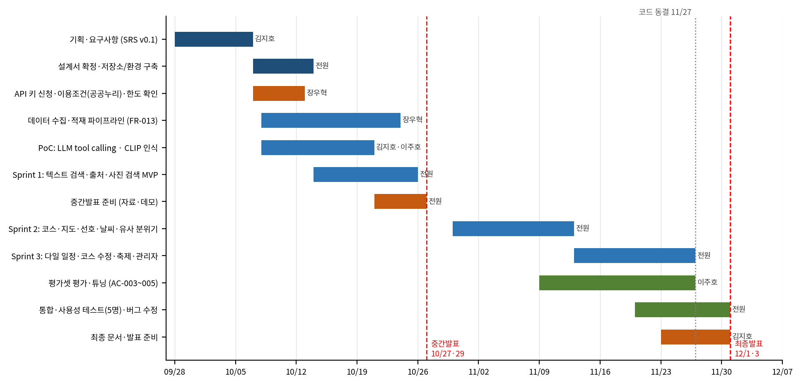

<!-- 02_프로젝트계획서_BusanMate.docx에서 자동 생성 (docs/docx2md.py). 직접 수정하지 말 것 -->

프로젝트 계획서

Project Plan

문서 코드: PLAN

| 프로젝트명 | BusanMate — 부산 맞춤 여행코스 안내 서비스 |
|---|---|
| 팀명 | [팀명 입력] |
| 팀원 | 김지호 / 2243577 / PM·LLM 에이전트 김성민 / 2242764 / 프론트, 연동 장우혁 / 2254772 / 데이터 엔지니어 이주호 / 2143325 / AI, 이미지 |
| 버전 | v0.1 |
| 작성일 | 2026-10-06 |
| 담당교수 | 임한신 |
| 과목 과제 | 부산지역안내서비스 (AI 기반 지역 안내 서비스) |

## 문서 관리

| 버전 | 날짜 | 작성자 | 변경 내용 |
|---|---|---|---|
| 0.1 | 2026-10-06 | 김지호 | 초안 작성 (SRS v0.1 기준) |
| 0.2 | [날짜] | [작성자] | [변경 내용] |
| 1.0 | [날짜] | [작성자] | 최종본 |

# 1. 프로젝트 개요

## 1.1 배경 및 문제 정의

부산 관광·문화 정보는 공공데이터포털, 한국관광공사 TourAPI 등 여러 곳에 흩어져 있어, 여행자가 장소·행사·날씨·이동 거리를 직접 비교하고 조합해 일정을 짜기 어렵다. 또한 일반 LLM은 최신 폐업·휴관 정보나 축제 일정을 반영하지 못해 존재하지 않거나 오래된 장소를 답할 위험이 있다(환각). 부산을 찾는 여행자는 대부분 1박 이상 머물기 때문에 당일 코스뿐 아니라 며칠 일정도 짜 줄 수 있어야 실제로 쓸모가 있다.

## 1.2 목적과 목표

실제 부산 공공데이터와 LLM/VLM을 결합해, 사용자의 조건(동행, 테마, 시간, 날씨)에 맞는 부산 여행 코스를 근거와 출처와 함께 제안하고, 사진 한 장으로 비슷한 부산 장소를 찾아 주는 AI 서비스 BusanMate를 개발한다.

서비스 목표: 자연어 질의로 반나절~최대 2박 3일 코스를 추천하고, 사진으로 장소를 탐색하며, 모든 추천에 데이터 출처를 표시한다.

품질 목표(SRS 수용 기준, 초안 값): 조건 추출 정확도 90% 이상, Precision@5 0.7 이상, 사진 Top-5 정확도 70% 이상, 응답 속 DB에 없는 장소 0건.

학습 목표: 요구사항 → 설계 → 구현 → 시험으로 이어지는 소프트웨어공학 프로세스를 GitHub 기반으로 수행하고, 산출물 간 추적성을 유지한다.

## 1.3 범위

| 구분 | 내용 |
|---|---|
| 포함 | 반나절~최대 2박 3일의 부산 일정 추천, 자연어 장소 검색(RAG), 선호·날씨·축제 반영, 지도·동선 표시, 사진 기반 장소 탐색(CLIP·VLM), 대화형 코스 수정, 공공데이터 수집·갱신(관리자) |
| 제외 | 숙박·교통 예약 및 결제, 숙소 추천, 부산 외 지역, 3박 이상 일정, 모바일 앱, 다국어 지원 |

## 1.4 과제 요건 대응

표 1. 과제 요건과 본 프로젝트의 대응

| 과제 요건 | 대응 방안 | 관련 문서 |
|---|---|---|
| AI(LLM/VLM) 활용 서비스 | LLM 에이전트(tool calling)로 질의 해석·도구 호출·설명 생성, VLM으로 사진 장면 설명. 단순 1회 호출이 아닌 다단계 구조 | SRS AI-REQ-04, 설계서 §9 |
| 실제 부산 데이터·API 사용 | 공공데이터포털 부산명소·맛집·축제 정보, TourAPI, 기상청 예보, 카카오맵·모빌리티 | SRS §7, 본 문서 §8 |
| 핵심 기능 3개 이상 | ① 자연어 장소 검색 ② 선호 반영 맞춤 코스 추천 ③ 사진 기반 장소 탐색 (+ 지도·날씨·축제는 부가) | SRS §3 |
| GitHub 기반 개발 | 저장소·이슈·PR·프로젝트 보드로 관리, API 키는 저장소에 올리지 않음 | 본 문서 §7, §11 |
| SW공학 프로세스 준수 | 계획서 → SRS → 설계서 → 구현 → 시험, 추적표(RTM) 유지 | 본 문서 §3 |
| 데이터 출처·저작권 명시 | 화면·README에 출처 표기, 이용 조건이 확인된 데이터·이미지만 사용 | SRS NFR-007, 본 문서 §8 |
| AI 활용 내역 공개 | 각 산출물 부록에 도구·일시·프롬프트·범위·검증 기재 | 각 문서 부록 |

# 2. 서비스 개요

## 2.1 핵심 기능

SRS의 기능 요구사항 14개를 우선순위(MoSCoW)별로 요약하면 다음과 같다. 일정이 빠듯해지면 Could → Should 순으로 줄이고 Must를 우선 완성한다.

표 2. 기능 요구사항 요약

| ID | 기능 | 핵심 내용 | 우선순위 | 담당 |
|---|---|---|---|---|
| FR-001 | 자연어 조건 추출 | 지역·날짜·기간·동행·테마·시간·이동수단 추출 | Must | 지호 |
| FR-002 | 하이브리드 장소 검색 | 의미 유사도 + 속성 조건(구·분류·실내·운영시간) | Must | 우혁 |
| FR-003 | 출처 표시 | 모든 장소에 제공처·원본 링크 | Must | 지호 |
| FR-004 | 날씨 반영 | 강수확률 60% 이상이면 실내 가중치 상향 | Could | 성민 |
| FR-005 | 선호 조건 설정 | 테마·이동수단·동행 선택, 세션 유지 | Must | 성민 |
| FR-006 | 코스 구성 | 점수화 + 하루당 2~6곳 순서 배치 | Must | 주호 |
| FR-007 | 지도·동선 표시 | 마커·경로·구간 이동시간 | Must | 성민 |
| FR-008 | 사진 기반 장소 인식 | 사진 업로드 → 유사 명소 탐색 | Must | 주호 |
| FR-009 | 유사 분위기 추천 | 유사도 낮을 때 장면 설명 기반 5곳 추천 | Must | 주호 |
| FR-010 | 축제 반영 | 방문 기간의 축제·행사 후보 포함 | Could | 우혁 |
| FR-011 | 근거 기반 설명 | DB 정보만으로 추천 이유 설명, 환각 0건 | Must | 지호 |
| FR-012 | 대화형 코스 수정 | 장소 교체·추가·삭제 부분 반영 | Should | 지호 |
| FR-013 | 데이터 수집·갱신 | 관리자 배치: 수집·정제·중복 제거·임베딩·적재 | Must | 우혁 |
| FR-014 | 다일 일정 구성 | 2~3일 일정을 날짜별 코스로 구성, 장소 중복 없음 | Should | 지호 |

## 2.2 사용자 시나리오

여행자가 "이번 토요일 부모님과 걸어서 돌기 좋은 바다 코스"처럼 입력하면 시스템이 조건을 추출하고, 후보를 검색·점수화해 순서가 정해진 코스와 추천 이유, 출처, 지도를 보여 준다.

여행자가 마음에 든 풍경 사진을 올리면 비슷한 부산 명소를 찾아 주고, 유사한 곳이 없으면 분위기가 비슷한 장소 5곳을 설명과 함께 추천한다.

"두 번째 장소 빼고 카페 넣어줘"처럼 말하면 나머지는 유지한 채 해당 장소만 바뀐다.

관리자는 배치를 실행해 공공 API 데이터를 갱신하고 수집 결과 로그를 확인한다.

# 3. 개발 방법론 및 프로세스

요구사항·설계 문서를 먼저 확정한 뒤 구현에 들어가는 계획 기반 프로세스를 큰 틀로 하되, 구현·시험 단계는 2주 단위 스프린트로 쪼개 매 스프린트 끝에 동작하는 결과물을 데모한다. 과제 일정(중간발표 10/27·29, 최종발표 12/1·3)이 고정되어 있어 범위 조절은 우선순위(MoSCoW)로 한다.

표 3. 단계별 산출물과 시점

| 단계 | 주요 활동 | 산출물 | 시점 |
|---|---|---|---|
| 계획 | 범위·일정·역할·위험 정의 | 프로젝트 계획서 | 10/6 초안, 중간발표 전 확정 |
| 요구분석 | 기능·비기능·데이터·AI 요구 정의, 수용 기준 | SRS, 추적표(RTM) | 10/6 초안, 설계와 함께 보완 |
| 설계 | 아키텍처·모듈·DB·API·알고리즘 설계 | 소프트웨어 설계서 | 10/13까지 확정 |
| 구현 | 스프린트 단위 개발, PR 리뷰 | 소스코드(GitHub), README | 10/14 ~ 11/27 |
| 시험 | 단위·통합·AI 평가·사용성 시험 | 시험 케이스·결과, 평가 보고 | 10/14 ~ 11/30 (지속) |
| 종료 | 최종 문서 정리, 발표, 회고 | 최종 문서 세트, 발표 자료 | 11/23 ~ 12/3 |

## 3.1 스프린트 운영

스프린트는 2주 단위로 시작할 때 목표와 이슈를 정하고, 끝날 때 데모와 회고를 한다.

정기 회의는 주 1회(요일·시간은 팀 합의 후 기입: [요일/시간]), 진행 상황·막힌 점·다음 주 계획을 공유한다.

기능 우선순위는 Must → Should → Could 순이다. 코드 동결(11/27) 이후에는 버그 수정과 문서만 한다.

# 4. 팀 구성 및 역할

4명이 모듈을 나눠 맡고, 모든 모듈은 다른 팀원 1명이 PR 리뷰어로 참여한다. 역할은 초안이며 진행 중 팀 합의로 조정할 수 있다.

표 4. 팀원별 역할과 담당 모듈

| 이름 | 학번 | 역할 | 담당 모듈·활동 | 담당 FR |
|---|---|---|---|---|
| 김지호 | 2243577 | PM, LLM 에이전트 | AgentOrchestrator, QueryParser, ResponseBuilder, SessionStore, 일정·문서 관리 | FR-001, 003, 011, 012, 014 |
| 김성민 | 2242764 | 프론트, 연동 (팀 대표) | Streamlit UI, FastAPI 엔드포인트, MapTool(카카오), WeatherTool, RoutePlanner | FR-004, 005, 007 |
| 장우혁 | 2254772 | 데이터 엔지니어 | DataPipeline, DB 스키마, SearchService, FestivalTool, Docker 구성 | FR-002, 010, 013 |
| 이주호 | 2143325 | AI, 이미지 | ImageService(CLIP·VLM), Scorer 튜닝, 평가셋 구축·AI 평가 | FR-006, 008, 009 |

공동: 설계 리뷰, 시험 케이스 작성(자기 모듈), 통합 시험, 발표 준비.

리뷰어 배정(초안): 지호↔성민, 우혁↔주호 상호 리뷰. 크로스 모듈 변경은 전원 확인.

의사결정: 합의를 원칙으로 하되, 일정·범위 충돌 시 PM이 우선순위 기준(MoSCoW)에 따라 조정하고 팀 대표가 확인한다.

# 5. 일정 계획

## 5.1 주요 마일스톤

표 5. 마일스톤

| 날짜 | 마일스톤 | 완료 기준 |
|---|---|---|
| 2026-10-06 | SRS v0.1 완료 | 요구사항 FR-001~014, NFR-001~011 정의 |
| 2026-10-13 | 설계서 확정, 개발 환경 구축 | 저장소·CI·Docker 구성, API 키 신청 완료, DB 스키마 확정 |
| 2026-10-25 | Sprint 1 종료 (MVP) | 텍스트 검색→출처 표시, 사진 검색 기본 동작 데모 |
| 2026-10-27 / 10-29 | 중간발표 | 계획서·SRS·설계서 + 프로토타입 시연 (팀 배정일에 발표) |
| 2026-11-12 | Sprint 2 종료 | 1일 코스 추천·지도·선호·날씨·유사 분위기 추천 동작 |
| 2026-11-26 | Sprint 3 종료 | 다일 일정·코스 수정·축제·관리자 기능 완성, 평가 결과 확보 |
| 2026-11-27 | 코드 동결 | 이후 버그 수정·문서만 |
| 2026-11-30 | 최종 문서·테스트 완료 | 수용 기준(AC-001~009) 확인 결과 정리 |
| 2026-12-01 / 12-03 | 최종발표 | 전체 데모, 평가 결과, 데이터 출처·AI 활용 내역 (팀 배정일) |

## 5.2 일정표

[그림 1] 프로젝트 일정 (막대 오른쪽은 담당자)

## 5.3 스프린트별 목표

표 6. 스프린트 목표

| 스프린트 | 기간 | 목표 (관련 FR) |
|---|---|---|
| Sprint 0 | 10/07 ~ 10/13 | 설계 확정, 저장소·CI·Docker, API 키 신청, DB 스키마, 공공누리·호출 한도 확인 |
| Sprint 1 | 10/14 ~ 10/25 | 수집·적재 파이프라인 1차(FR-013 기본), 조건 추출·하이브리드 검색·출처·근거 설명(FR-001~003, 011), 사진 인식 기본(FR-008) |
| 중간발표 | 10/27 ~ 10/29 | 자료 준비(10/21~26), 시연 시나리오 리허설 |
| Sprint 2 | 10/30 ~ 11/12 | 선호 설정(FR-005), 코스 구성(FR-006), 지도·동선(FR-007), 날씨(FR-004), 유사 분위기 추천(FR-009) |
| Sprint 3 | 11/13 ~ 11/26 | 다일 일정(FR-014), 코스 수정(FR-012), 축제(FR-010), 관리자 인증·로그·멱등성(FR-013 완성), 평가·튜닝 |
| 마무리 | 11/20 ~ 11/30 | 통합·사용성 시험(5명 이상), 버그 수정, 최종 문서·발표 준비 |

※ 일정은 초안이며 중간발표 직후 실제 속도를 반영해 Sprint 2·3의 범위를 다시 조정한다. 시험 기간 등 개인 일정은 팀 캘린더에 공유해 반영한다.

# 6. 산출물 계획

표 7. 산출물 목록

| 산출물 | 내용 | 담당 | 제출/확정 시점 |
|---|---|---|---|
| 프로젝트 계획서 | 범위·일정·역할·위험·품질 계획 | 김지호 | 중간발표(10/27·29) |
| 요구사항 명세서(SRS) | FR·NFR·UC·데이터·AI 요구, 수용 기준, RTM | 전원(김지호 정리) | 중간발표 |
| 소프트웨어 설계서 | 아키텍처·모듈·DB·API·알고리즘·시퀀스 | 전원(모듈별 작성) | 중간발표 |
| 소스코드·README | GitHub 저장소, 실행 방법, 출처 표기 | 전원 | 지속, 11/27 동결 |
| 시험 문서 | 시험 케이스(TC), 결과, AI 평가 보고 | 모듈 담당 + 이주호 | 11/30 |
| 평가셋 | 질의 50개 + 정답, 미사용 사진 테스트셋 | 이주호 | Sprint 2 중 구축 |
| 발표 자료 | 중간·최종 발표 슬라이드, 시연 시나리오 | 전원 | 10/26, 11/30 |
| AI 활용 내역 | 도구·일시·프롬프트·범위·검증 | 김지호(전원 확인) | 각 문서 부록 |

# 7. 기술 스택 및 개발 환경

표 8. 기술 스택

| 영역 | 선택 | 비고 |
|---|---|---|
| 언어·런타임 | Python 3.11 | 팀 공통 (SRS §2.3) |
| 프론트엔드 | Streamlit | 채팅·사진 업로드·지도 화면 |
| 백엔드 | FastAPI | REST API, 관리자 인증 토큰 |
| 에이전트 | LangChain / LangGraph | tool calling 기반 다단계 구조 |
| DB | PostgreSQL + Chroma | 장소 속성 / 텍스트·이미지 벡터 |
| 임베딩·모델 | CLIP 계열(이미지), 다국어 텍스트 임베딩, tool calling 지원 LLM·VLM API | 구체 모델은 Sprint 0~1 PoC에서 비교 후 확정 |
| 지도·길찾기 | 카카오맵, 카카오 모빌리티(도보·자동차) | 대중교통은 직선거리 기반 추정치 |
| 날씨 | 기상청 단기·중기예보 | 공공데이터포털 경유 |
| 배포 | Docker / Docker Compose | app, api, postgres, chroma |
| 품질 | pytest, ruff, pre-commit(gitleaks), GitHub Actions | PR마다 lint·테스트 자동 실행 |

## 7.1 GitHub 운영 규칙

main은 보호 브랜치로 두고 직접 푸시하지 않는다. 작업은 feature/<기능> 브랜치에서 하고 PR로 병합한다.

PR은 리뷰어 1명 이상의 승인과 CI 통과 후 병합한다. PR 본문에 관련 FR/이슈 번호를 적는다.

이슈와 프로젝트 보드(칸반)로 작업을 관리하고, 이슈 제목에 FR-ID를 포함해 추적성을 유지한다.

커밋 메시지는 feat:, fix:, docs:, test: 접두어를 사용한다.

API 키는 .env로만 관리하고 저장소에 올리지 않는다. .env.example만 공유하며 secret 스캔을 켠다.

# 8. 데이터 및 외부 API 계획

표 9. 데이터 출처와 확인 상태

| ID | 데이터·API | 용도 | 상태 / 확인 필요 |
|---|---|---|---|
| DATA-01 | 공공데이터포털 부산명소정보·부산맛집정보, TourAPI 국문 관광정보 | 장소 정보 배치 수집 | 서비스 공개 확인(2026-10-06). 공공누리 유형·호출 한도 미확인 |
| DATA-02 | TourAPI 등 장소 이미지 | 사진 인식 인덱스 | 이용 조건이 확인된 이미지만 사용 |
| DATA-03 | 공공데이터포털 부산축제정보, TourAPI 행사 | 축제 반영 | 서비스 공개 확인. 이용 조건 확인 필요 |
| DATA-04 | 기상청 단기·중기예보 | 날씨 반영 | 질의 시 조회, 1시간 캐시 |
| DATA-05 | 카카오 모빌리티 길찾기(도보·자동차), 카카오맵 | 이동시간·지도 | 저장·캐시 안 함(카카오 답변상 임시 캐싱 금지). 약관·한도 확인 필요 |

## 8.1 저작권·출처 관리 절차

API 키 신청 시 각 서비스의 이용 조건(공공누리 유형, 호출 한도, 상업적 이용·가공 허용 여부)을 원문에서 확인해 표로 기록한다. 담당: 장우혁.

이용 조건이 불명확한 이미지·데이터는 수집 대상에서 제외하거나 출처만 링크로 표시한다.

DB의 장소·이미지 레코드에 license 필드를 두어 이용 조건을 함께 저장한다.

화면과 README에 데이터 제공처와 이용 조건을 표기한다. 발표 자료에도 출처 슬라이드를 포함한다.

# 9. 품질 관리 계획

## 9.1 품질 목표

표 10. 정량 목표 (SRS 수용 기준 기반, 초안 값)

| AC | 목표 | 관련 요구사항 | 확인 방법 |
|---|---|---|---|
| AC-002 | 코스 요청 후 15초 이내(중앙값, 1일 기준)에 코스·이유·지도 표시 | FR-006, 007, NFR-001 | Acceptance Test |
| AC-003 | 평가 질의 50개에서 조건 추출 90% 이상, Precision@5 0.7 이상 | FR-001, 002, AI-REQ-05 | AI Evaluation |
| AC-004 | 응답 속 DB에 없는 장소 0건 | FR-011, AI-REQ-01 | AI Evaluation |
| AC-005 | 미사용 사진 테스트셋 Top-5 정확도 70% 이상 | FR-008, AI-REQ-06 | AI Evaluation |
| AC-006 | 외부 API 장애 시에도 DB·캐시(이동시간은 추정치)로 응답하고 안내 | NFR-003, AI-REQ-02 | System Test |
| AC-007 | 수집 배치 2회 연속 실행 시 중복 0건, 로그 생성 | FR-013 | Acceptance Test |
| AC-008 | 처음 쓰는 사용자 5명 이상이 3분 안에 코스 수신 | NFR-008 | Usability Test |
| AC-009 | 2박 3일 요청 시 날짜별 코스 표시, 장소 중복 없음 | FR-014 | Acceptance Test |

수치는 초안 값이며 프로토타입 평가 결과를 보고 팀이 조정한다. 조정 시 SRS와 본 문서를 함께 수정한다.

## 9.2 시험 전략

단위 시험: 모듈별 pytest. 외부 API는 mock으로 대체해 장애 상황(AC-006)을 재현한다.

통합 시험: 시나리오(UC-001~007) 단위로 API 엔드투엔드 시험.

AI 평가: 평가셋으로 조건 추출·검색·환각·사진 인식 지표를 자동 계산해 스프린트마다 기록한다.

사용성 시험: Sprint 3 이후 5명 이상에게 설명 없이 코스를 요청하게 하고 소요 시간과 막힌 지점을 기록한다.

## 9.3 평가셋 구축 계획

질의 50개: 단순 검색, 조건 조합(동행·테마·시간·날씨), 다일 일정, 모호·결과 없음 질의를 섞어 구성하고 정답 조건과 정답 장소를 사람이 라벨링한다. 구성 비율은 Sprint 1에서 정한다.

사진 테스트셋: 인덱스에 쓰지 않은 사진으로 구성한다(예: 명소 약 20곳 × 3장, 초안 규모). 직접 촬영하거나 이용 조건이 확인된 사진만 쓴다.

담당: 이주호가 구축하고, 라벨은 다른 팀원 1명이 교차 확인한다.

## 9.4 코드 리뷰와 완료 기준

PR 체크리스트: 관련 FR/이슈 연결, 시험 추가, 비밀값 미포함, 출처·저작권 영향 확인.

기능 완료(DoD): 코드 리뷰 승인, 단위 시험 통과, 해당 TC 작성, 추적표 상태 갱신.

# 10. 위험 관리

표 11. 위험과 대응 (가능성·영향: 상/중/하)

| ID | 위험 | 가능성 | 영향 | 대응 | 담당 |
|---|---|---|---|---|---|
| R1 | API 키 승인 지연·미승인 | 중 | 상 | 즉시 신청, 승인 전에는 파일 데이터·샘플로 개발. 승인 현황을 주간 점검 | 우혁 |
| R2 | 공공누리 유형·호출 한도 미확인 | 중 | 중 | 신청 시 원문 확인·기록, 불명확한 이미지는 제외, 한도 내 배치 설계 | 우혁 |
| R3 | 데이터 품질(좌표 누락, 중복, 비정형 운영시간) | 상 | 중 | 필수값 검증, 누락 항목 제외·로그, 운영시간 파싱 실패 시 "정보 없음" 처리 | 우혁 |
| R4 | LLM 환각 | 중 | 상 | 장소는 DB id로만 인용, verify_places 검증, 평가셋 자동 대조 | 지호 |
| R5 | 사진 인식 정확도 미달, 장소당 이미지 부족 | 상 | 중 | 임계값 보정, 미달 시 유사 분위기 추천으로 폴백, 필요 시 목표 조정 | 주호 |
| R6 | 카카오 도보 길찾기 권한 미승인·캐싱 제한 | 중 | 중 | 직선거리 추정으로 폴백(요구사항에 반영), 이동시간은 저장하지 않음 | 성민 |
| R7 | LLM/VLM API 비용·지연 | 중 | 중 | 호출 로그 집계, LLM 응답 캐시(이동시간 제외), 응답시간 측정, 모델 단계화 | 지호 |
| R8 | 병행 과목·시험 기간으로 일정 지연 | 상 | 중 | Must 우선, Could→Should 순 컷, 11/27 코드 동결, 주간 점검 | 지호 |
| R9 | 역할 편중·팀원 부재 | 하 | 상 | 모듈별 리뷰어 지정, 문서·README로 인수인계 가능하게 유지 | 전원 |
| R10 | 다일 일정(FR-014) 복잡도 | 중 | 중 | Should로 지정, 1일 코스 안정화 후 착수, 미완 시 향후 과제로 정리 | 지호 |
| R11 | API 키 유출 | 하 | 상 | .env 관리, pre-commit gitleaks, 저장소 secret 스캔, 유출 시 즉시 재발급 | 전원 |
| R12 | AI 활용 내역 누락 | 하 | 상 | 모든 문서 부록에 기재, 프롬프트 기록 유지 | 지호 |

# 11. 의사소통 및 형상 관리

연락: 팀 메신저 채널 [채널명 입력], 주 1회 정기 회의, 스프린트 종료 시 데모·회고.

이슈 관리: GitHub Issues + 프로젝트 보드. 라벨은 FR-ID, Must/Should/Could, bug/docs로 구분.

문서 관리: 문서는 docs/ 폴더에 두고 버전 이력 표를 갱신한다. 요구사항이 바뀌면 SRS → 설계서 → RTM 순으로 반영한다.

변경 관리: 요구사항 변경은 이슈로 제안하고 PM 검토 후 팀 합의로 확정한다. 변경 사유와 날짜를 문서 이력에 남긴다.

# 12. 자원 및 비용

| 항목 | 내용 |
|---|---|
| 인력 | 팀원 4명 (역할은 §4) |
| 개발·실행 환경 | 개인 PC + Docker. 배포 서버 필요 여부는 발표 방식 확정 후 결정 [확정 필요] |
| 외부 API | 공공데이터포털, TourAPI, 기상청, 카카오(지도·모빌리티): 무료 한도 내 사용 가정 (한도는 확인 필요) |
| LLM/VLM API 비용 | 팀 예산 안에서 사용. 월 상한 [금액 입력]. 호출 로그로 사용량을 집계한다 (NFR-010) |

# 13. 발표 계획

| 발표 | 계획 |
|---|---|
| 중간발표 (10/27 또는 10/29) | 계획서·SRS·설계서 요약, 아키텍처, Sprint 1 MVP 시연(텍스트 검색→출처, 사진 검색 1건), 이후 계획과 위험. 발표일은 팀 배정에 따름 |
| 최종발표 (12/1 또는 12/3) | 전체 기능 시연(코스·다일 일정·사진 탐색), 평가 결과(AC), 시험 결과, 데이터 출처·저작권, AI 활용 내역, 회고 |

# 14. 미결 사항

아래 항목은 현재 확정되지 않았으며, 확인 후 문서를 갱신한다.

팀명, 정기 회의 요일·시간, 메신저 채널

중간·최종 발표 배정일 (10/27 vs 10/29, 12/1 vs 12/3)

LLM/VLM·임베딩 모델 선정 (Sprint 0~1 PoC 후)

각 공공 API의 공공누리 유형·호출 한도, 카카오 도보 길찾기 사용 승인 여부와 약관

LLM/VLM API 월 비용 상한, 배포 서버 필요 여부

수용 기준 수치(AC)의 최종 조정 — 프로토타입 평가 후

과목의 AI 활용 허용 범위(자료 검색·요약 외 문서 초안 작성 포함 여부)를 담당 교수님께 확인

# 부록. AI 활용 내역

본 문서는 AI(Claude)가 작성한 초안을 바탕으로 한다. "팀 수정 사항"과 "검증"은 팀이 직접 채운다.

| 사용 도구 | Claude (Anthropic), Cowork 모드 |
|---|---|
| 사용 일시 | 2026-09-28 ~ 2026-10-06 |
| 활용 범위 | 주제 아이디어 제안, 계획서·요구사항정의서·설계서 초안 작성, SRS 양식 작성, 본 계획서 재작성(SRS v0.1 기준), 다이어그램(일정표) 작성, AI 자체 검토·오류 수정 |
| 입력 프롬프트 | ① 과제 공지문 전문 + "프로젝트 아이디어 제공해줘" ② "1번을 기본으로 하고 2번의 이미지 기능을 합치는 것으로 하자" ③ 계획서 초안 요청(팀 4명, Python 중심 스택) ④ "그럼 이제 요구사항정의서랑 설계서 만들어줘" ⑤ 1박 이상 일정을 범위에 포함해 달라는 요청 |
| 팀 수정 사항 | [팀이 직접 바꾼 내용을 기입: 예) 역할 분담 확정, 일정 조정] |
| 검증 | [팀이 직접 확인한 내용을 기입] 참고(AI 조사, 2026-10-06): 공공데이터포털에 부산명소정보·부산맛집정보·부산축제정보 서비스가 공개되어 있고, 카카오 모빌리티 개발자 문서에 도보·자동차 길찾기 API가 있으며, 카카오 담당자는 개발자 포럼에서 이동 시간의 임시 캐싱을 금지한다고 답했다. 각 API의 이용 조건과 호출 한도는 팀이 원문에서 직접 확인해야 한다. 일정·역할·위험·평가셋 규모는 AI가 제안한 초안 값이다. |
