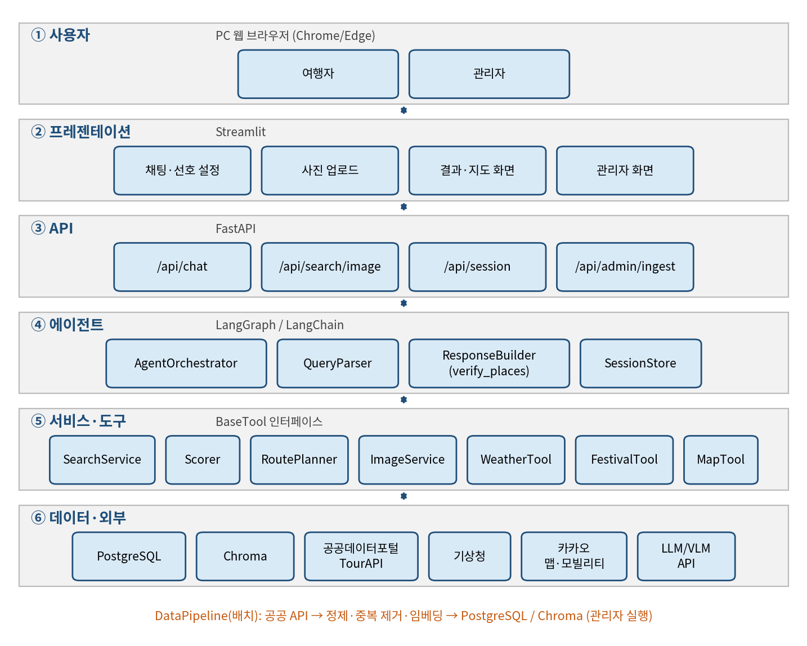
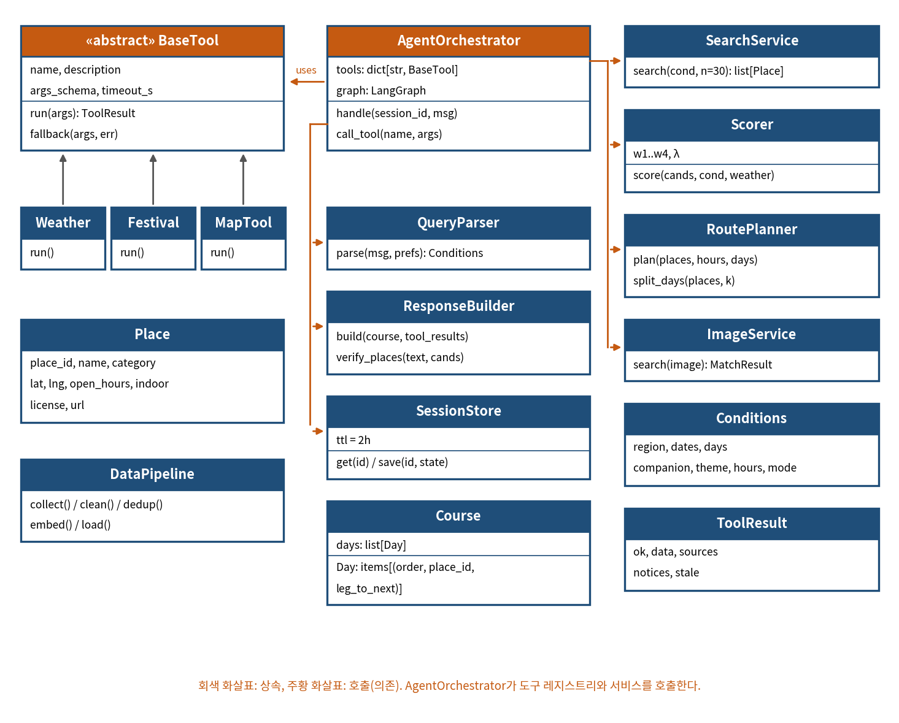
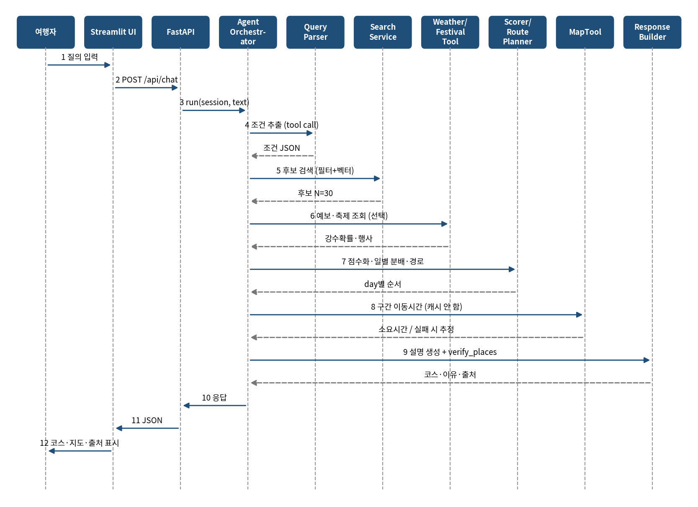
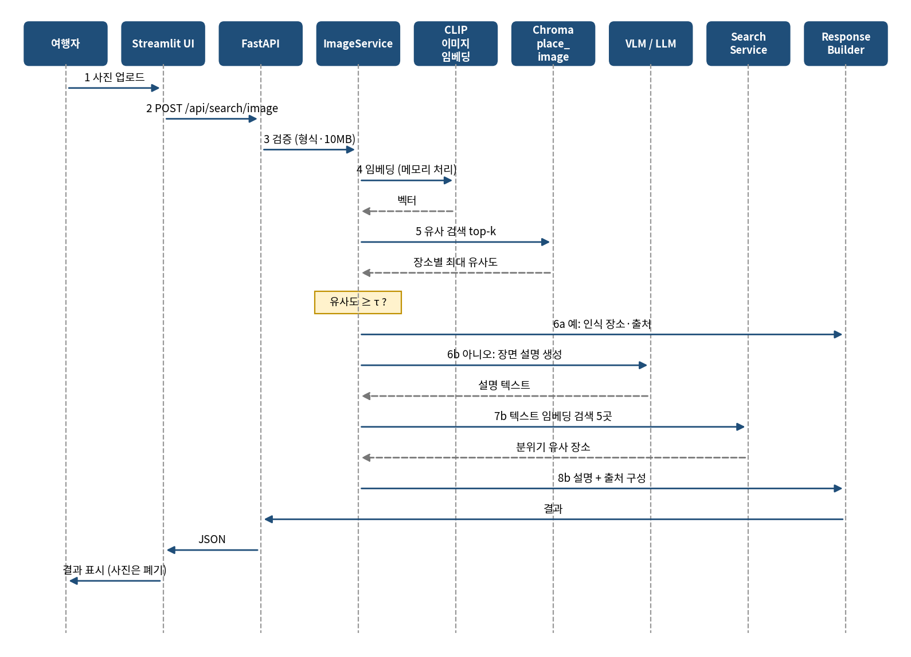
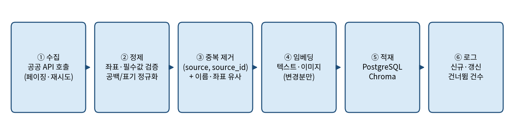
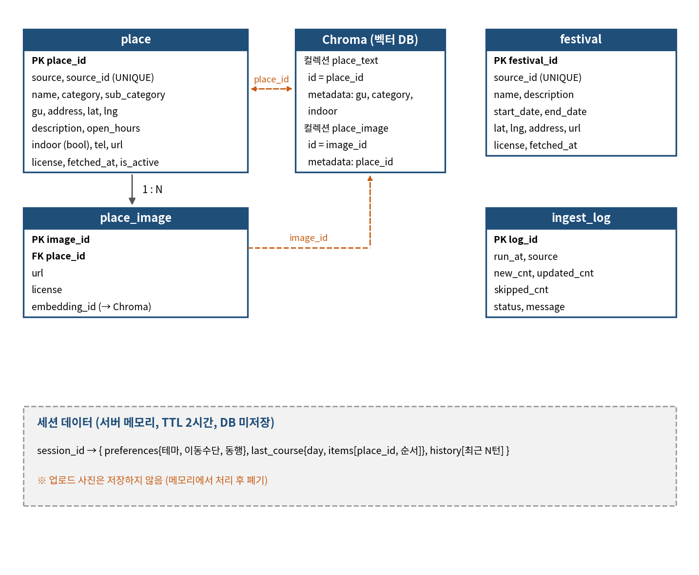
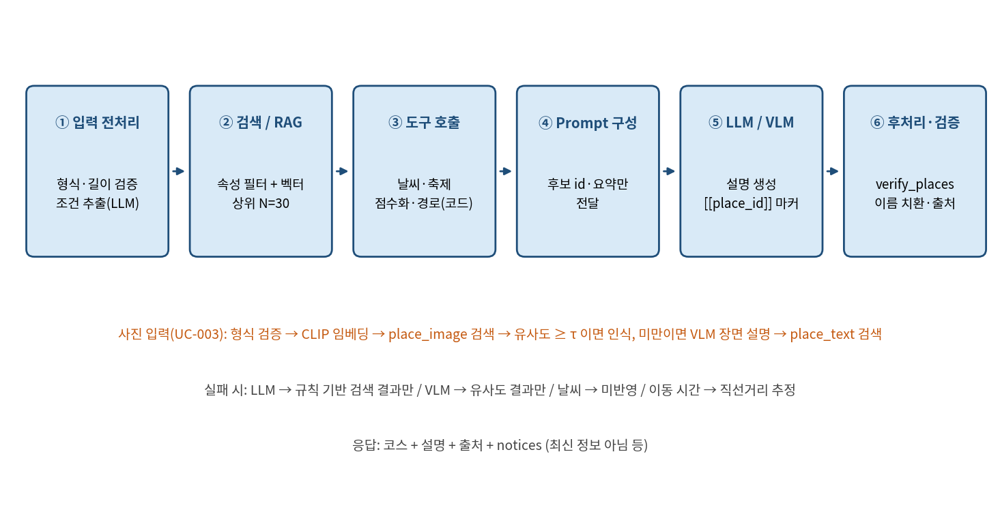
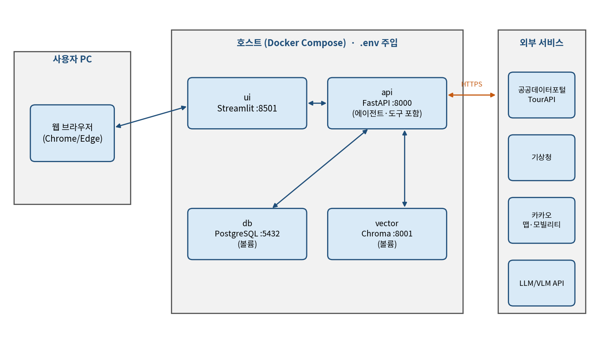

<!-- 03_소프트웨어설계서_BusanMate.docx에서 자동 생성 (docs/docx2md.py). 직접 수정하지 말 것 -->

소프트웨어 설계 명세서

Software Design Document (SDD)

문서 코드: SDD

| 프로젝트명 | BusanMate — 부산 맞춤 여행코스 안내 서비스 |
|---|---|
| 팀명 | [팀명 입력] |
| 팀원 | 김지호 / 2243577 / PM·LLM 에이전트
김성민 / 2242764 / 프론트, 연동
장우혁 / 2254772 / 데이터 엔지니어
이주호 / 2143325 / AI, 이미지 |
| 버전 | v1.0 |
| 작성일 | 2026-10-13 |
| 담당교수 | 임한신 |

.

# 문서 관리

| 버전 | 날짜 | 작성자 | 변경 내용 |
|---|---|---|---|
| 0.1 | 2026-10-06 | 김지호 | 초안 작성 (SRS v0.1 기준) |
| 0.2 | 2026-10-13 | 김지호 | 요구사항-설계 추적성 강화 (SRS 최종본 기준) |
| 1.0 | 2026-10-13 | 김지호 | 최종본 |

# 1. 설계 개요 (Design Overview)

## 1.1 목적 및 범위

본 문서는 SRS에 정의된 BusanMate의 요구사항(FR-001~014, NFR-001~011, AI-REQ-01~06)을 어떻게 구현할지 설계한다. 범위는 서비스 전체(프론트엔드, API, 에이전트, 도구, 데이터 파이프라인)이며, 숙박·교통 예약, 숙소 추천, 부산 외 지역, 3박 이상 일정, 모바일 앱, 다국어는 설계 대상이 아니다. 본 문서의 수치와 임계값은 초안 값이며 프로토타입 평가 후 조정한다.

추적성 원칙: 주요 설계 요소에는 관련 SRS 요구사항 ID(FR/NFR/AI-REQ)를 명시

## 1.2 관련 문서

요구사항 명세서(SRS) v1.0 — BusanMate

프로젝트 계획서 v1.0 — BusanMate

공공데이터포털·TourAPI, 기상청, 카카오 맵·모빌리티 공식 문서 (이용 조건과 호출 한도는 API 키 신청 시 확인)

## 1.3 설계 목표 및 품질 속성

| 품질 속성 | 목표 | 설계 대응 | 관련 NFR |
|---|---|---|---|
| 근거 신뢰성 | 추천 장소 100%가 DB에 존재하고 출처 표시 | LLM은 장소를 id로만 인용하고 verify_places가 DB와 대조, 이름·좌표·출처는 DB에서 채움 | NFR-004, AI-REQ-01 |
| 성능 | 텍스트 검색 5초, 1일 코스 15초(2박 3일 30초), 사진 검색 10초 이내(중앙값) | 하이브리드 검색으로 후보 30개로 축소, 점수화·경로 계산은 코드로 처리, 응답 캐시 | NFR-001, NFR-002 |
| 가용성·오류 복구 | 외부 API 장애에도 서비스 지속 | DB·캐시 데이터로 응답하고 최신 정보가 아님을 안내, 이동 시간은 비저장·실패 시 직선거리 추정 | NFR-003, AI-REQ-02 |
| 유지보수성 | 도구 추가 시 에이전트 코드 무수정 | 외부 연동을 공통 BaseTool 인터페이스로 구현, LLM/VLM 클라이언트 분리 | NFR-009 |
| 보안·개인정보 | 키 노출 0건, 사진 비저장 | API 키는 .env 주입, 업로드 사진은 메모리에서만 처리, 로그에 개인정보 미기록 | NFR-005, NFR-006, AI-REQ-03 |
| 저작권·출처 | 이용 조건 확인 데이터만 사용 | DataPipeline이 이용 조건(license)을 함께 적재하고 화면에 출처 표기 | NFR-007, FR-003 |
| 사용성·비용 | 처음 쓰는 사용자가 3분 내 코스 수령, API 비용 예산 내 | 단일 채팅 화면과 선호 설정, 호출 로그 집계와 응답 캐시 | NFR-008, NFR-010 |

# 2. 시스템 아키텍처 (System Architecture)

## 2.1 전체 아키텍처

시스템은 사용자, 프레젠테이션, API, 에이전트, 서비스·도구, 데이터·외부의 6계층으로 구성한다. 상위 계층은 바로 아래 계층만 호출한다. 공공 데이터는 DataPipeline이 배치로 수집해 자체 DB에 적재하고, 날씨·이동시간처럼 자주 바뀌는 정보만 질의 시점에 외부 API에서 조회한다.

[그림 1] 시스템 아키텍처 (6계층 구조)

표 1. 계층별 구성요소와 책임

| 계층 | 구성요소 | 책임 | 관련 요구사항 |
|---|---|---|---|
| 프레젠테이션 | Streamlit 앱 | 채팅 입력, 사진 업로드, 선호 설정, 코스·지도·출처 표시, 관리자 화면. 상태는 session_id만 보유 | FR-005, FR-007, NFR-008 |
| API | FastAPI | 요청 검증, 세션 식별, 관리자 토큰 검사, 요청 한도, 오류 응답 표준화 | FR-013, NFR-005 |
| 에이전트 | AgentOrchestrator, QueryParser, ResponseBuilder, SessionStore | LangGraph로 질의 흐름과 도구 호출 제어, 조건 추출, 설명 생성과 verify_places 장소 검증, 세션 보관(TTL 2시간) | FR-001, FR-011, FR-012, AI-REQ-04, AI-REQ-05 |
| 서비스·도구 | SearchService, Scorer, RoutePlanner, ImageService, WeatherTool, FestivalTool, MapTool | 하이브리드 검색, 점수화·장소 선택·방문 순서 최적화, 사진 인식, 예보·행사·이동시간 조회 (도구는 BaseTool 구현) | FR-002, FR-004, FR-006~010, FR-014 |
| 데이터·외부 | PostgreSQL, Chroma, DataPipeline, 외부 API | 장소 속성 / 텍스트·이미지 벡터 저장, 공공 API 수집·정제·적재, 공공데이터포털·TourAPI·기상청·카카오·LLM/VLM 연동 | FR-003, FR-013, NFR-003, NFR-007 |

## 2.2 아키텍처 스타일 및 선택 이유

| 결정 ID | 선택 | 이유 | 대안/Trade-off | 관련 요구사항 |
|---|---|---|---|---|
| ADR-001 | 계층형 + 클라이언트-서버, 모놀리식 API | 책임 분리가 쉽고 4인 팀·짧은 기간에 배포와 디버깅이 단순함 | 서비스 분리 대비 확장성이 낮고 계층 호출 오버헤드가 생김 | NFR-009 |
| ADR-002 | RAG (속성 필터 + 벡터 하이브리드 검색)와 [[place_id]] 검증 | 부산 공공 데이터를 근거로 답하고 환각을 막음 | 임베딩 구축 비용과 검색 품질 튜닝 필요 | AI-REQ-01, NFR-004, FR-002 |
| ADR-003 | LLM 에이전트(LangGraph)는 해석·도구 선택·설명, 점수화·경로 최적화는 코드 | 결과가 결정적이어서 시험이 쉽고 LLM 비용·오류 영향이 작음 | LLM의 도구 선택 오류 가능, 단계 수 제한 필요 | AI-REQ-04, FR-006 |
| ADR-004 | 공공 데이터는 배치 적재, 날씨·이동시간만 실시간 조회 | 호출 한도와 응답시간 확보, 이동 시간은 약관상 캐싱 금지 가능성 반영 | 데이터 최신성이 배치 주기에 의존 | NFR-001, NFR-003 |
| ADR-005 | PostgreSQL(속성) + Chroma(벡터) 이원 저장 | 관계형 질의와 벡터 검색을 각각 최적 도구로 처리 | 두 저장소의 동기화 관리 필요 | FR-002, FR-008 |
| ADR-006 | 외부 연동 도구의 공통 BaseTool 인터페이스 | 도구를 추가해도 에이전트 코드를 고치지 않음 | 추상화 계층에 따른 초기 구현 비용 | NFR-009 |
| ADR-007 | 세션은 서버 메모리(TTL 2시간), 업로드 사진은 비저장 | 개인정보 최소화와 구현 단순화 | 서버 재시작 시 세션 소실 | NFR-006, AI-REQ-03, FR-012 |
| ADR-008 | LLM·VLM 응답 캐시 (이동 시간 제외) | 응답시간 단축과 API 비용 절감 | 캐시 일관성·만료 관리 필요 | NFR-001, NFR-010 |

# 3. 컴포넌트 설계 (Component Design)

| ID | 컴포넌트 | 책임 | 입력 | 출력 | 의존성 | 관련 요구사항 |
|---|---|---|---|---|---|---|
| COMP-01 | Streamlit UI | 채팅·사진 업로드·선호 설정, 코스·지도·출처 표시, 관리자 화면 | 사용자 입력, 파일 | HTTP 요청, 화면 | COMP-02 | FR-005, FR-007, NFR-008 |
| COMP-02 | API 서버 (FastAPI) | 요청 검증, 세션 식별, 관리자 토큰 검사, 요청 한도, 오류 응답 표준화 | HTTP 요청 | JSON 응답 | COMP-03, COMP-08, COMP-12 | FR-013, NFR-005 |
| COMP-03 | AgentOrchestrator | LangGraph로 질의 흐름 제어, 도구 선택·호출, 턴당 도구 호출 6회 제한 | message, session_id | 코스·응답 | COMP-04~11 | FR-011, FR-012, AI-REQ-04 |
| COMP-04 | QueryParser | 조건 추출(지역·날짜·기간·동행·테마·시간·이동수단), 되묻기 판단 | 질의, 선호 | Conditions | COMP-11 | FR-001, AI-REQ-05 |
| COMP-05 | SearchService | 속성 필터 + 벡터 하이브리드 검색, 후보 N=30, 조건 완화 | Conditions | 후보 장소 목록 | PostgreSQL, Chroma | FR-002, AI-REQ-01 |
| COMP-06 | Scorer · RoutePlanner | 점수화, 장소 수 결정, 다양성 보정, 일별 분배, 방문 순서 최적화 | 후보, Conditions, 날씨 | 일별 코스 | COMP-07 | FR-004~006, FR-014 |
| COMP-07 | 도구 어댑터 (Weather·Festival·Map) | 예보·행사·이동시간 조회, BaseTool 구현, 실패 시 폴백 | 날짜·지역·코스 | ToolResult | 기상청, DB, 카카오 | FR-004, FR-007, FR-010, NFR-003, NFR-009 |
| COMP-08 | ImageService | 사진 검증·임베딩, 유사 장소 탐색, VLM 장면 설명 폴백 | 이미지 바이트 | 유사 장소 5곳 | Chroma, COMP-11 | FR-008, FR-009, AI-REQ-06 |
| COMP-09 | ResponseBuilder | 설명 생성, verify_places 장소 검증, 출처 첨부, 응답 조립 | 코스, 도구 결과 | 최종 응답 | COMP-11, PostgreSQL | FR-003, FR-011, NFR-004 |
| COMP-10 | SessionStore | 선호·직전 코스·대화 이력 보관 (TTL 2시간) | session_id | 세션 상태 | 서버 메모리 | FR-005, FR-012 |
| COMP-11 | LLM/VLM Client | 모델 호출 추상화, 응답 캐시, 호출 로그 기록 | Prompt, 이미지 | 모델 응답 | LLM/VLM API | AI-REQ-02, NFR-009, NFR-010 |
| COMP-12 | DataPipeline | 공공 API 수집·정제·중복 제거·임베딩·적재, 수집 로그 | 관리자 실행 | 적재 결과·로그 | 공공 API, PostgreSQL, Chroma | FR-013, NFR-007 |

## 3.1 핵심 처리 로직

아래 수치(가중치, 임계값, 체류 시간 등)는 초안 값이며 config.yaml로 분리해 평가 결과를 보고 조정한다.

조건 추출 (COMP-04, FR-001): LLM의 structured output으로 지역·날짜·기간(1~3일)·동행·테마·시간·이동수단을 JSON으로 만든다. 지역·날짜가 없으면 되묻고, 나머지는 선호 설정과 기본값(하루 9시간)을 쓴다. 기간이 3일을 넘으면 3일로 줄이고 안내한다.

하이브리드 검색 (COMP-05, FR-002): 구·분류·실내 여부·운영 시간 속성 필터를 적용한 뒤 Chroma 유사도 검색으로 상위 30곳을 가져온다. 후보가 2곳 미만이면 운영시간 → 실내 여부 → 구 순서로 조건을 풀어 다시 검색하고 풀었음을 안내한다.

점수화 (COMP-06, FR-004~006): S(p) = w1·sim + w2·pref + w3·weather − w4·dist (초기 가중치 0.4 / 0.3 / 0.2 / 0.1). weather 항은 강수확률 60% 이상이면 실내 1, 실외 0을 주고 예보가 없으면 중립 0.5를 준다.

코스 구성 (COMP-06, FR-006): 장소 수 K = clamp(floor(가용시간 / (평균 체류 + 평균 이동)), 2, 6). 점수 순으로 고르되 같은 분류가 이미 선택됐으면 λ=0.1씩 감점하고, 방문 순서는 K ≤ 6이므로 모든 순열(최대 720가지) 중 이동거리가 최소인 것을 고른다. 같은 분류 3곳 연속은 제외하며, 시간이 초과되면 최저 점수 장소를 빼고 운영시간 밖이면 다음 후보로 교체한다.

다일 일정 (COMP-06, FR-014): 상위 N일 × K곳을 후보 풀로 잡고 위·경도 k-means(k=일수)로 지리적 그룹을 나눈다. 강수확률 60% 이상인 날에는 실내 비율이 높은 그룹을 배정하고, 일정 전체에서 장소 중복이 없도록 교체 후보를 관리한다.

이동 시간 (COMP-07, FR-007): 자동차는 카카오 모빌리티 길찾기 API(자동차 경로만 제공)로 구간별 조회한다. 도보·대중교통과 조회 실패 시에는 직선거리 × 구간 보정계수(같은 구 1.3, 인접 구 1.5, 바다·다리 구간 1.8)로 추정해 "예상"으로 표시한다. 약관상 캐싱 금지 가능성이 있어 이동 시간은 저장하지 않는다.

사진 탐색 (COMP-08, FR-008·009): 형식·용량(JPG/PNG, 10MB) 검증 후 메모리에서 CLIP 임베딩을 만들어 place_image를 검색한다. 최고 유사도가 τ=0.80 이상이면 장소를 인식하고, 미만이거나 부산 밖 사진이면 VLM 장면 설명을 임베딩해 place_text에서 비슷한 분위기의 장소 5곳을 찾는다. 처리 후 이미지는 폐기한다.

## 3.2 BaseTool 인터페이스

외부 연동 도구는 모두 공통 BaseTool 인터페이스를 구현한다. BaseTool은 name, description, args_schema, timeout_s 속성과 run(args) → ToolResult, fallback(args, err) 메서드를 가진다. ToolResult는 ok, data, sources(제공처·원본 링크), notices(사용자 안내), stale(대체 데이터 여부)를 담는다. AgentOrchestrator는 도구 레지스트리에서 이름으로 도구를 찾아 호출하므로 도구를 추가해도 에이전트 코드는 바뀌지 않는다 (NFR-009).

# 4. UML 설계

## 4.1 Class Diagram

[그림 2] 클래스 다이어그램 (핵심 서비스·도구 클래스)

관련 요구사항: FR-001~FR-014, NFR-009

관련 Use Case: UC-001~UC-007

## 4.2 Sequence Diagram

[그림 3] SD-01. UC-002 맞춤 여행코스 추천 시퀀스

관련 Use Case: UC-002    관련 요구사항: FR-001~FR-007, FR-010, FR-011, FR-014, AI-REQ-01, AI-REQ-04

[그림 4] SD-02. UC-003 사진으로 장소 탐색 시퀀스

관련 Use Case: UC-003    관련 요구사항: FR-008, FR-009, AI-REQ-03, AI-REQ-06

## 4.3 기타 UML (선택)

[그림 5] 데이터 수집 파이프라인 (Activity)

관련 요구사항/Use Case: FR-013, NFR-007 / UC-007

# 5. 데이터베이스 및 데이터 설계

## 5.1 ER Diagram / Data Model

[그림 6] 데이터 구조 (PostgreSQL / Chroma / 세션)

관련 요구사항: FR-002, FR-003, FR-008, FR-010, FR-013, NFR-006, NFR-007

## 5.2 테이블/컬렉션 정의

| 테이블/컬렉션 | 필드 | 타입 | PK/FK | Null | 설명 | 관련 요구사항 |
|---|---|---|---|---|---|---|
| place | place_id | BIGSERIAL | PK | N | 내부 식별자 (LLM이 인용하는 id) | FR-002 |
| place | source, source_id | VARCHAR | UNIQUE | N | 수집 출처와 원본 id | FR-013 |
| place | name | VARCHAR | - | N | 장소명 | FR-001 |
| place | category, sub_category | VARCHAR | - | N / Y | 분류, 세부 분류 | FR-002, FR-006 |
| place | gu, address | VARCHAR | - | N | 구, 주소 | FR-002 |
| place | lat, lng | DOUBLE | - | N | 좌표 (없으면 적재 제외) | FR-007 |
| place | description | TEXT | - | Y | 설명 (텍스트 임베딩 원문) | FR-002, FR-011 |
| place | open_hours | TEXT/JSONB | - | Y | 운영시간 (파싱 실패 시 원문) | FR-006 |
| place | indoor | BOOLEAN | - | Y | 실내 여부 (불명이면 NULL) | FR-004 |
| place | tel, url | VARCHAR | - | Y | 연락처, 원본 링크 (출처 표시) | FR-003 |
| place | license | VARCHAR | - | N | 이용 조건 (공공누리 유형 등) | FR-003, NFR-007 |
| place | fetched_at, is_active | TIMESTAMP, BOOL | - | N | 수집 시각, 활성 여부 | FR-013 |
| place_image | image_id | BIGSERIAL | PK | N | 이미지 식별자 | FR-008 |
| place_image | place_id | BIGINT | FK | N | place 참조 | FR-008 |
| place_image | url, license | VARCHAR | - | N | 이미지 위치, 이용 조건 (확인된 것만 적재) | NFR-007 |
| place_image | embedding_id | VARCHAR | - | Y | Chroma 벡터 id | FR-008, FR-009 |
| festival | festival_id | BIGSERIAL | PK | N | 행사 식별자 | FR-010 |
| festival | source_id | VARCHAR | UNIQUE | N | 원본 id | FR-013 |
| festival | name, description | VARCHAR, TEXT | - | N / Y | 행사명, 설명 | FR-010 |
| festival | start_date, end_date | DATE | - | N | 기간 (겹치는 행사 조회) | FR-010 |
| festival | lat, lng, address, url | DOUBLE, VARCHAR | - | Y | 위치, 원본 링크 | FR-003, FR-010 |
| festival | license, fetched_at | VARCHAR, TIMESTAMP | - | N | 이용 조건, 수집 시각 | NFR-007 |
| ingest_log | log_id | BIGSERIAL | PK | N | 로그 식별자 | FR-013 |
| ingest_log | run_at, source | TIMESTAMP, VARCHAR | - | N | 실행 시각, 소스 | FR-013 |
| ingest_log | new_cnt, updated_cnt, skipped_cnt | INT | - | N | 신규·갱신·건너뜀 건수 | FR-013 |
| ingest_log | status, message | VARCHAR, TEXT | - | N / Y | 결과 상태, 메시지 | FR-013 |

Chroma 컬렉션과 세션은 아래와 같이 구성한다.

place_text: id=place_id, 문서=이름+설명, 메타데이터=gu·category·indoor, 코사인 유사도.

place_image: id=image_id, 메타데이터=place_id. 사진 검색 후 place_id별 최대 유사도로 집계한다.

세션: 서버 메모리 dict(TTL 2시간). preferences{테마, 이동수단, 동행}, last_course, 최근 대화 N턴을 두며 DB에는 저장하지 않는다. 업로드 사진도 저장하지 않는다 (NFR-006).

# 6. API 설계

| API ID | Method | Endpoint | 목적 | Request | Response | 관련 요구사항 |
|---|---|---|---|---|---|---|
| API-001 | POST | /api/chat | 자연어 질의 → 코스·설명·출처 | {session_id, message} | {answer, conditions, course, sources, notices} | FR-001~007, FR-010~012, FR-014 |
| API-002 | POST | /api/search/image | 사진 → 인식 결과 또는 유사 장소 5곳 | multipart (session_id, file) | {mode, matches, sources, notices} | FR-008, FR-009 |
| API-003 | GET | /api/session/{id}/preferences | 선호 조회 | - | {theme, mode, companion} | FR-005 |
| API-004 | PUT | /api/session/{id}/preferences | 선호 설정 | {theme, mode, companion} | {ok} | FR-005 |
| API-005 | GET | /api/session/{id}/course | 직전 코스 조회 | - | {course} | FR-007, FR-012 |
| API-006 | POST | /api/admin/ingest | 수집 배치 실행 (X-Admin-Token) | {sources?} | {run_id} | FR-013 |
| API-007 | GET | /api/admin/ingest/{run_id} | 수집 상태·결과 조회 | - | {status, new, updated, skipped} | FR-013 |
| API-008 | GET | /api/health | 상태 확인 | - | {status} | NFR-003 |

chat 응답의 course는 일자별 items(order, place_id, name, lat, lng, reason, leg_to_next{minutes, meters, estimated})로 구성하며, answer 속 장소 마커는 서버가 DB의 장소명으로 치환한 뒤 반환한다. 관리자 API는 X-Admin-Token 헤더를 환경변수의 토큰과 상수 시간 비교로 검사한다.

공통 오류 응답

| HTTP / code | 상황 | 시스템 동작 | 사용자 안내 |
|---|---|---|---|
| 400 INVALID_INPUT | 필수 조건(지역·날짜) 누락, 잘못된 파라미터 | 처리 중단 | 부족한 조건을 되묻는다 |
| 401 UNAUTHORIZED | 관리자 토큰 없음·불일치 | 요청 거부 | 관리자 권한이 필요합니다 |
| 413/415 FILE_* | 10MB 초과, JPG/PNG 아님 | 요청 거부 | 허용 형식·용량 안내 |
| 429 RATE_LIMITED | 세션당 분당 20회 초과 (초안) | 요청 거부 | 잠시 후 다시 시도 |
| 502/504 UPSTREAM_* | LLM/VLM·외부 API 실패 | 폴백 응답 | 최신 정보 아님 표시 |
| 500 INTERNAL | 처리되지 않은 오류 | 일반 오류 응답 | 상세는 로그에만 기록 |

# 7. AI / LLM / VLM 설계

## 7.1 AI 파이프라인

[그림 7] AI 파이프라인

관련 요구사항: AI-REQ-01~AI-REQ-06, FR-001, FR-008, FR-011, NFR-004

에이전트 도구 목록

| 도구 | 역할 | 주요 인자 | 구현 모듈 |
|---|---|---|---|
| search_places | 조건에 맞는 후보 검색 | Conditions | SearchService |
| get_weather | 방문일 강수확률 조회 | date, region | WeatherTool |
| get_festivals | 방문 기간 행사 조회 | start, end | FestivalTool |
| build_course | 점수화·일별 분배·순서 결정 | candidates, Conditions, days | Scorer, RoutePlanner |
| get_route_times | 구간 이동 시간 조회 | course, mode | MapTool |
| edit_course | 교체·추가·삭제 부분 반영 | op, target_index, spec | Orchestrator, Scorer |
| search_by_image | 사진 검색 (별도 엔드포인트) | image_ref | ImageService |

LLM은 질의 의도(검색·코스·수정)에 따라 필요한 도구를 선택하고, 점수화·경로·시간 계산은 도구 안의 코드가 수행한다 (AI-REQ-04).

한 턴의 도구 호출은 최대 6회로 제한하고, build_course는 search_places 결과가 있을 때만 실행한다. 순서가 어긋난 호출은 오류로 돌려 LLM이 다시 선택하게 한다.

## 7.2 모델 및 인터페이스

| AI 요소 | 모델/서비스 | 역할 | 입력/출력 | 교체 가능성/추상화 | 관련 요구사항 |
|---|---|---|---|---|---|
| LLM | Google Gemini (AI Studio 무료 등급) | 조건 추출, 도구 선택, 설명 생성 | Text+Context → JSON/Text | LLMClient 인터페이스 | AI-REQ-01, AI-REQ-04, FR-001, FR-011 |
| VLM | Google Gemini (멀티모달) | 사진 장면 설명 (유사도 미달 시) | Image+Text → Text | VLMClient 인터페이스 | AI-REQ-06, FR-009 |
| 텍스트 임베딩 | 미정 (한국어 지원 모델) | 장소 설명·질의 벡터화 | Text → Vector | EmbeddingProvider | FR-002, AI-REQ-01 |
| 이미지 임베딩 | CLIP 계열 | 사진·장소 이미지 벡터화 | Image → Vector | EmbeddingProvider | FR-008, AI-REQ-06 |

## 7.3 Prompt  설계

System Prompt 목적: 도구 결과에 있는 장소만 언급하고, 장소는 [[place_id]] 마커로만 가리키게 하며, 모르면 모른다고 답하고 필수 조건이 없으면 되묻게 한다. 숙박·예약·결제는 다루지 않고 한국어로 답한다. 프롬프트는 agent/prompts/에 버전과 함께 관리한다.

검색 대상 데이터/Chunk 전략: 장소 1건을 1개 문서(이름 + 설명)로 임베딩하며 별도 분할은 하지 않는다. 사진은 장소별 이미지 1장당 1벡터로 저장한다. LLM에는 후보를 id, 이름, 분류, 한 줄 요약 형태로만 보여 준다.

Top-k 또는 Retrieval 기준: 속성 필터 통과 후보 중 의미 유사도 상위 N=30을 가져와 점수화로 K곳(2~6)을 고른다. 사진은 상위 10개 이미지를 place_id별 최대 유사도로 집계해 5곳을 만들고, 유사도 τ=0.80 이상이면 인식으로 처리한다.

출처 표시 방식: 응답에 포함된 모든 장소에 제공처, 원본 링크, 이용 조건(license)을 붙이며 화면 하단과 README에도 표기한다. 출처가 없는 장소는 응답에서 제외한다.

Hallucination 완화 방법: LLM은 이번 턴의 후보만 보고, 응답은 마커로만 장소를 가리킨다. verify_places가 모든 마커 id가 DB·후보 집합에 있는지 확인해 없으면 해당 문장을 제거하고 통과한 마커는 DB의 이름으로 치환한다. 문장 속 가짜 장소명은 규칙만으로 모두 걸러낼 수 없으므로 평가 질의 50개로 DB와 자동 대조해 0건을 측정한다.

관련 요구사항: AI-REQ-01, AI-REQ-04, FR-003, FR-011, NFR-004

## 7.4 AI 실패/예외 처리

| 상황 | 처리 전략 | 사용자 메시지/로그 | 관련 요구사항 |
|---|---|---|---|
| LLM API Timeout·오류 | 키워드·규칙 기반 간이 추출로 검색 결과만 반환, 같은 질의의 응답 캐시가 있으면 사용 | "AI 설명을 만들지 못해 검색 결과만 보여 드립니다" / 오류·지연 로그 | AI-REQ-02 |
| VLM 실패 | CLIP 유사도 결과만 반환 | "사진 설명 없이 유사한 장소만 보여 드립니다" | AI-REQ-02 |
| 기상청 예보 실패 | 날씨 반영 없이 진행 (weather 항 중립) | "날씨 정보를 가져오지 못해 반영하지 않았습니다" | AI-REQ-02, NFR-003 |
| 이동 시간 API 실패 | 직선거리 기반 추정치로 대체 (저장 안 함) | "이동 시간은 직선거리 기반 예상치입니다" | NFR-003 |
| 근거 부족 (후보 2곳 미만) | 조건을 단계적으로 완화해 재검색, 그래도 없으면 결과 없음 안내 | "조건을 조금 넓혀 볼까요?" 완화 내용 표시 | AI-REQ-01 |
| 장소 검증 실패 | 검증 실패 문장 제거, 후보 외 장소 미노출 | 검증 실패 로그 (장소 id) | AI-REQ-01, NFR-004 |
| 부적절 입력 (형식·길이) | 검증 후 차단, 파일 형식·용량 위반은 413/415 | 허용 형식·용량 안내 | AI-REQ-03 |

# 8. 예외 처리 및 로깅

| 오류 ID | 오류 상황 | 시스템 동작 | 로그/모니터링 | 관련 요구사항 |
|---|---|---|---|---|
| ERR-001 | 잘못된 입력 (필수 조건 누락) | 400 응답, 되묻기 | 입력 오류 로그 | FR-001, FR-002 |
| ERR-002 | 관리자 토큰 불일치 | 401 응답 | 인증 실패 로그 (토큰 미기록) | FR-013, NFR-005 |
| ERR-003 | 파일 형식·용량 위반 | 413/415 응답 | 입력 오류 로그 (크기·형식만) | FR-008, NFR-006 |
| ERR-004 | 요청 한도 초과 | 429 응답 | 한도 초과 로그 | NFR-001 |
| ERR-005 | 외부 AI(LLM/VLM) 장애 | 폴백 응답 + 안내 (502/504) | 오류·응답시간·폴백 사용 로그 | AI-REQ-02, NFR-003 |
| ERR-006 | 기상청·카카오 API 실패 | 날씨 미반영 / 직선거리 추정 | 도구별 오류 로그 | FR-004, FR-007, NFR-003 |
| ERR-007 | 장소 검증 실패 (환각 의심) | 해당 문장 제거 | 검증 실패 로그 (장소 id) | FR-011, NFR-004 |
| ERR-008 | 수집 소스 실패 | 해당 소스 건너뜀, 최대 3회 재시도 | ingest_log, 관리자 화면 | FR-013 |
| ERR-009 | DB·벡터 저장소 장애 | 500 응답 (일반 메시지) | 오류 로그, 상세는 서버 로그에만 | NFR-003 |

로깅 정책

구조화(JSON) 로그에 request_id, 세션 해시, 단계별 지연, 도구 호출 목록, 오류 코드, 폴백 사용 여부를 남긴다.

LLM·VLM 호출 로그에 모델, 입출력 토큰, 추정 비용, 지연을 남기고 일 단위로 집계해 팀 예산 대비를 확인한다 (NFR-010).

질의 원문, 업로드 사진, API 키·토큰은 로그에 남기지 않는다 (NFR-005, NFR-006).

# 9. 보안 및 개인정보 설계

인증/권한: 일반 사용자는 로그인 없이 session_id 단위로 사용한다. 관리자 API는 X-Admin-Token 헤더를 환경변수의 토큰과 상수 시간 비교로 검사한다.

API Key/Secret 관리: 모든 비밀값은 .env 환경변수로 주입하고 저장소에는 .env.example만 올린다. pre-commit gitleaks와 GitHub secret 스캔을 켠다.

개인정보 저장 최소화: 업로드 사진은 메모리에서만 처리하고 응답 후 폐기한다. 세션은 서버 메모리에 TTL 2시간으로 두며 회원정보는 수집하지 않는다.

입력/출력 검증: 파일 형식(확장자·매직바이트)과 10MB 제한, 질의 길이 제한, Pydantic 스키마 검증, 세션당 분당 20회 요청 한도. 출력은 verify_places 검증을 거친 장소만 반환한다.

로그에 민감정보를 남기지 않음: 로그에는 요청 id, 세션 해시, 도구별 소요시간, 오류 코드만 남기고 질의·사진 원문은 남기지 않는다.

## 관련 요구사항 매핑

| 보안/개인정보 설계 요소 | 관련 요구사항 |
|---|---|
| 인증/권한 | FR-013, NFR-005 |
| API Key/Secret 관리 | NFR-005 |
| 개인정보 저장 최소화 | NFR-006, AI-REQ-03 |
| 입력/출력 검증 | NFR-004, NFR-006, AI-REQ-03 |
| 민감정보 로그 방지 | NFR-006, AI-REQ-03 |

# 10. 배포 및 운영 설계

## 10.1 Deployment Diagram

[그림 8] 배포 구성 (Docker Compose)

관련 요구사항: NFR-005, NFR-006, NFR-011

| 서비스 | 이미지/기술 | 포트(초안) | 비고 |
|---|---|---|---|
| ui | Python 3.11 + Streamlit | 8501 | api만 호출 |
| api | Python 3.11 + FastAPI(uvicorn) | 8000 | 에이전트·도구·서비스 포함 (모놀리식) |
| db | PostgreSQL | 5432 | 볼륨으로 데이터 영속화 |
| vector | Chroma (퍼시스턴트 디렉터리) | 8001 | 볼륨으로 인덱스 영속화 |

에이전트와 도구를 api 프로세스 안에 두는 모놀리식 구조로 시작하며, 팀 규모와 기간을 고려해 서비스 분리는 하지 않는다. 저장소는 ui/, api/, agent/, tools/, services/, pipeline/, db/, eval/, tests/, docs/ 디렉터리로 나눈다.

## 10.2 CI/CD

Repository/Branch 전략: GitHub 저장소의 main은 보호 브랜치로 두고 직접 푸시하지 않는다. 작업은 feature/<기능> 브랜치에서 하고 PR로 병합한다.

Pull Request/Review 규칙: 리뷰어 1명 이상의 승인과 CI 통과 후 병합한다. PR 본문에 관련 FR/이슈 번호를 적는다.

자동 Build/Test: GitHub Actions에서 PR마다 ruff(lint), pytest, gitleaks(secret 스캔)를 실행한다.

배포 환경: Docker Compose (발표 시연용 로컬 실행 또는 서버 배포는 미결, 아래 10.4 참고).

관련 요구사항: NFR-005, NFR-009, NFR-011

## 10.3 성능 예산

| 단계 | 예산 | 비고 | 관련 NFR |
|---|---|---|---|
| 조건 추출 (LLM) | 2초 | 구조화 출력, 짧은 프롬프트 | NFR-001 |
| 검색 (SQL + Chroma) | 1초 | N=30 | NFR-001 |
| 날씨·축제 조회 | 1초 | 병렬 호출, 날씨 1시간 캐시 | NFR-001 |
| 점수화·경로 계산 | 1초 미만 | 하루 최대 720가지 전수 탐색 | NFR-001 |
| 이동 시간 조회 | 3초 | 구간 병렬 호출, 시간 초과 시 추정 | NFR-001, NFR-003 |
| 설명 생성·검증 (LLM) | 6초 | 장소별 reason 일괄 생성 | NFR-001 |
| 합계 (1일 코스) | 약 14초 | 목표 15초. 2박 3일은 날짜별 병렬화로 30초 | NFR-001 |
| 사진 검색 | 10초 이내 | 임베딩 + 검색 + (폴백 시) VLM | NFR-002 |

가중치(w1~w4), 다양성 보정 λ, 구간 보정계수표, 강수확률 임계값, 후보 수 N, 기본 체류 시간, 이동 속도, 사진 임계값 τ, 세션 TTL, 요청 한도, 도구 timeout은 config.yaml로 관리하고 비밀값만 .env에 둔다.

## 10.4 설계 미결 사항

텍스트 임베딩, CLIP 모델 선정: 개발 초기 PoC에서 정확도·지연·비용을 비교해 확정한다. LLM/VLM은 Gemini(무료 등급)로 정했다.

공공 API 실제 응답 필드와 DB 컬럼 매핑, 운영시간 형식, indoor 추정 규칙: API 키 승인 후 샘플로 확인한다.

가중치, 강수확률 임계값, τ, 체류 시간·이동 속도, 구간 보정계수: 평가셋과 실측(대표 구간 약 20쌍)으로 조정한다.

카카오 길찾기 API 호출 가능 여부와 약관(캐싱 금지 범위), 도보 경로 API 필요 여부, 카카오맵 활성화·도메인 등록을 확인한다.

세션 보관 방식(현재 서버 메모리, 필요 시 Redis 등)과 배포 방식(로컬 시연 vs 서버)을 결정한다.

# 11. 디자인 패턴 및 주요 설계 원칙

| 패턴/원칙 | 적용 위치 | 적용 이유 | 관련 클래스/컴포넌트 | 관련 요구사항 |
|---|---|---|---|---|
| Adapter / Strategy | LLM/VLM Client | 모델 제공자 교체 용이 | LLMClient, VLMClient | NFR-009, AI-REQ-02 |
| Registry + Interface | BaseTool 도구 레지스트리 | 도구 추가 시 에이전트 코드 무수정 | BaseTool, ToolResult | NFR-009, AI-REQ-04 |
| Template Method | BaseTool.run / fallback | 도구별 실패 처리 규약 통일 | Weather·Festival·MapTool | NFR-003 |
| Pipeline | DataPipeline | 수집·정제·적재 단계 분리와 재실행(멱등) | DataPipeline | FR-013 |
| Layered Architecture | 전체 6계층 | 책임 분리, 계층 간 단방향 호출 | COMP-01~12 | NFR-009 |
| Graceful Degradation | 외부 API 호출부 | 장애 시 DB·추정치로 응답 | 도구 어댑터 | NFR-003, AI-REQ-02 |
| Externalized Config | config.yaml, .env | 수치 조정·비밀값 분리 | 설정 모듈 | NFR-005, NFR-009 |

# 12. 요구사항-설계 추적표

| 요구사항 ID | Use Case | 아키텍처/컴포넌트 | Class/DB | API | Sequence | Test Case | 상태/비고 |
|---|---|---|---|---|---|---|---|
| FR-001 | UC-001, UC-002 | COMP-03, COMP-04 | Conditions | API-001 | SD-01 | TC-001 | Draft |
| FR-002 | UC-001, UC-002 | COMP-05 | place / Chroma | API-001 | SD-01 | TC-002 | Draft |
| FR-003 | UC-001~003 | COMP-09 | place.url, license | API-001, API-002 | SD-01, SD-02 | TC-003 | Draft |
| FR-004 | UC-002 | COMP-06, COMP-07 | Scorer | API-001 | SD-01 | TC-004 | Draft |
| FR-005 | UC-002, UC-006 | COMP-10, COMP-06 | SessionStore | API-003, API-004 | - | TC-005 | Draft |
| FR-006 | UC-002, UC-005 | COMP-06 | Scorer, RoutePlanner | API-001 | SD-01 | TC-006 | Draft |
| FR-007 | UC-002, UC-004, UC-005 | COMP-07, COMP-01 | MapTool | API-001, API-005 | SD-01 | TC-007 | Draft |
| FR-008 | UC-003 | COMP-08 | ImageService / place_image | API-002 | SD-02 | TC-008 | Draft |
| FR-009 | UC-003 | COMP-08, COMP-05 | ImageService | API-002 | SD-02 | TC-009 | Draft |
| FR-010 | UC-002 | COMP-07 | festival | API-001 | SD-01 | TC-010 | Draft |
| FR-011 | UC-002 | COMP-03, COMP-09 | verify_places | API-001 | SD-01 | TC-011 | Draft |
| FR-012 | UC-005 | COMP-03, COMP-10 | SessionStore | API-001, API-005 | - | TC-012 | Draft |
| FR-013 | UC-007 | COMP-12, COMP-02 | ingest_log | API-006, API-007 | - | TC-013 | Draft |
| FR-014 | UC-002 | COMP-03, COMP-06 | RoutePlanner | API-001 | SD-01 | TC-014 | Draft |
| NFR-001 | - | COMP-03, COMP-11 | 응답 캐시 | API-001 | SD-01 | TC 추가 예정 | Draft |
| NFR-002 | - | COMP-08 | ImageService | API-002 | SD-02 | TC 추가 예정 | Draft |
| NFR-003 | - | COMP-07, COMP-11 | 폴백 (§7.4) | API-001 | SD-01 | TC 추가 예정 | Draft |
| NFR-004 | - | COMP-09 | verify_places | API-001 | SD-01 | TC 추가 예정 | Draft |
| NFR-005 | - | COMP-02 | .env, gitleaks | API-006 | - | TC 추가 예정 | Draft |
| NFR-006 | - | COMP-08, 로깅 | 메모리 처리, 로그 정책 | API-002 | SD-02 | TC 추가 예정 | Draft |
| NFR-007 | - | COMP-12 | place.license | - | - | TC 추가 예정 | Draft |
| NFR-008 | - | COMP-01 | Streamlit UI | - | - | TC 추가 예정 | Draft |
| NFR-009 | - | COMP-07, COMP-11 | BaseTool | - | - | TC 추가 예정 | Draft |
| NFR-010 | - | COMP-11 | 호출 로그, 응답 캐시 | - | - | TC 추가 예정 | Draft |
| NFR-011 | - | COMP-01 | Streamlit UI | - | - | TC 추가 예정 | Draft |
| AI-REQ-01 | UC-002 | COMP-05, COMP-09 | verify_places / Chroma | API-001 | SD-01 | TC-011 | Draft |
| AI-REQ-02 | UC-002 | COMP-07, COMP-11 | 폴백 (§7.4) | API-001 | SD-01 | TC 추가 예정 | Draft |
| AI-REQ-03 | UC-003 | COMP-08 | 메모리 처리 | API-002 | SD-02 | TC 추가 예정 | Draft |
| AI-REQ-04 | UC-002 | COMP-03 | BaseTool | API-001 | SD-01 | TC 추가 예정 | Draft |
| AI-REQ-05 | UC-002 | COMP-04 | Conditions | API-001 | SD-01 | TC-001 | Draft |
| AI-REQ-06 | UC-003 | COMP-08, COMP-11 | ImageService | API-002 | SD-02 | TC-008, TC-009 | Draft |

※ NFR 항목의 Test Case는 SRS 추적표와 같이 추가 예정이다. 구현·테스트가 진행되면서 API/Class/Test Case 매핑을 보완한다.
